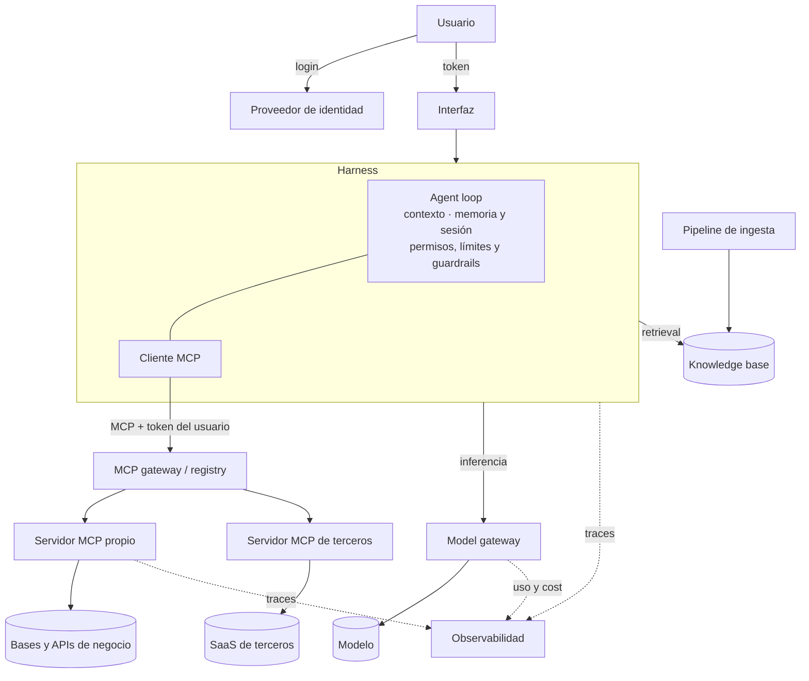
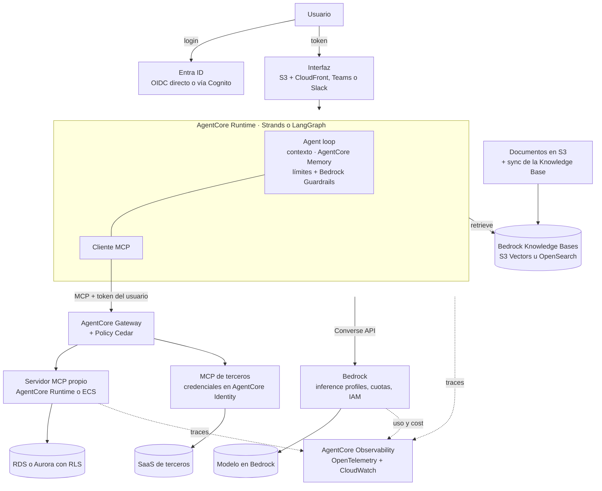

# 01 · Anatomía de un sistema agéntico

## Concepto

Un **agente** es un sistema que usa un modelo de lenguaje para decidir, en un loop, qué acciones ejecutar para cumplir un objetivo, y observa el resultado de cada acción antes de decidir la siguiente.

La palabra clave es **loop**. Un chatbot hace una llamada al modelo y devuelve la respuesta. Un agente llama al modelo, ejecuta lo que el modelo pidió, le devuelve el resultado y vuelve a llamarlo, hasta que el objetivo se cumple o se alcanza un límite.

## Por qué hace falta separar capas

Si decís "el agente consulta la base", en esa frase se esconden al menos cinco componentes con dueños, ubicaciones y modos de fallo distintos:

- El **modelo** decidió que había que consultar.
- El **harness** recibió esa decisión y la ejecutó.
- El **cliente MCP** dentro del harness armó el pedido.
- El **servidor MCP** recibió el pedido, validó la identidad y ejecutó la query.
- La **base** aplicó (o no) el control de acceso.

Cuando algo sale mal (una fuga de datos, un costo disparado, una respuesta inventada), la pregunta útil es **en qué capa falló**. Sin el mapa de capas, el diagnóstico es "la IA se equivocó", que no es accionable.

## El mapa completo

Este es el mapa de **anatomía pura**: componentes, sin productos. Cada caja existe en cualquier implementación, la operes vos o un proveedor.

Dos lecturas del mapa:

- **Los gateways son capas de gobierno opcionales, y aplican igual a todo lo que está detrás.** El model gateway centraliza cuotas y costo de *todos* los modelos. El MCP gateway centraliza autenticación, políticas y auditoría de *todos* los servidores MCP, propios o de terceros. Con un solo servidor MCP y un solo modelo, el harness se conecta directo y el gateway sobra (capítulo 07).
- **La identidad viaja con cada salto.** El token del usuario entra por la interfaz, el harness lo propaga por MCP y el servidor que toca los datos lo valida. El capítulo 10 desarrolla ese recorrido.

### El mismo mapa sobre AWS

Misma forma, cada caja con su servicio gestionado. La equivalencia en ChatGPT Enterprise y en infraestructura propia (servidores o contenedores) está en la tabla de mapeo del [capítulo 15](15-servicios-gestionados.md#la-tabla-de-mapeo).

## Las piezas, una por una

| Pieza | Qué es | Dónde corre | Analogía de sistemas |
|---|---|---|---|
| **Modelo** | Red neuronal que, dado un texto, predice el siguiente token. Sin estado entre requests | Infraestructura del proveedor. Lo consumís por HTTPS | CPU |
| **Context window** | Todo el texto que el modelo ve en **un** request: instrucciones, historial, resultados de tools. Tiene un tamaño máximo en tokens | Existe solo durante el request | RAM de un proceso efímero |
| **System prompt** | Instrucciones de mayor jerarquía: rol, reglas, formato, contexto de negocio estable | Lo escribís vos y lo carga el harness | Configuración del proceso |
| **Harness** | El programa que ejecuta el loop: arma el contexto, llama al modelo, ejecuta tools, maneja errores, estado y permisos | Tu infraestructura, o un servicio gestionado | Sistema operativo + scheduler |
| **Framework** | Librería con la que se escribe un harness (Claude Agent SDK, Strands, LangGraph) | Dentro del proceso del harness | Framework web (Django, Express) |
| **Runtime / hosting** | Dónde se ejecuta el proceso del harness (ECS, Lambda, AgentCore Runtime, laptop) | Infra | EC2 vs Fargate vs Lambda |
| **Tool** | Capacidad que el modelo puede pedir: nombre + descripción + schema de parámetros. El modelo **pide** y el harness **ejecuta** | Donde viva el código que la implementa | Syscall |
| **MCP** | Protocolo estándar para que un harness descubra y llame tools, lea recursos y use prompts de servidores externos | Cliente en el harness, servidor en cualquier lado | Protocolo de drivers (USB, ODBC) |
| **Skill** | Paquete de instrucciones y archivos que el agente carga **solo cuando la tarea lo necesita** | Filesystem del harness o un store | Librería con lazy loading |
| **Memoria** | Información que persiste entre sesiones y el harness reinyecta en el contexto | Store del harness (archivos, DB) | Disco persistente |
| **Knowledge base** | Corpus de documentos indexados para recuperar fragmentos relevantes (RAG) | Vector store o motor de búsqueda | Índice de búsqueda |
| **Pipeline de ingesta** | Proceso offline que lleva documentos al knowledge base: extrae, divide, vectoriza e indexa con permisos | Batch o por eventos | ETL |
| **Model gateway** | Proxy entre tus apps y los proveedores: cuotas, routing de modelos, costos por equipo, logs | Tu infra o SaaS | API gateway |
| **MCP gateway / registry** | Catálogo de servidores MCP aprobados con autenticación, políticas y auditoría centralizadas | Tu infra o servicio gestionado | Service mesh + artifact registry |
| **Identidad** | Autenticación del usuario y propagación de su identidad hasta los datos | IdP (Entra ID, Okta) + validación en cada salto | IAM + SSO |
| **Guardrails** | Filtros sobre entradas y salidas: PII, temas prohibidos, detección de injection | En el harness o en el gateway | WAF |
| **Observabilidad** | Traces de cada paso del loop: prompts, tool calls, tokens, latencia, costo | Pipeline OTel hacia un backend | APM |
| **Evals** | Suites de pruebas que miden la calidad del comportamiento del agente | CI/CD y producción (online) | Tests de regresión |

## Tres distinciones que tenés que poder explicar sin dudar

### Modelo ≠ agente

"Llamo al agente en Bedrock" es incorrecto. En Bedrock llamás al **modelo**. El agente es la combinación de modelo, harness, tools e instrucciones. La excepción son los servicios que **hospedan el harness** por vos (AgentCore Harness, Claude Managed Agents): ahí sí llamás a un agente, porque el proveedor corre el loop.

### Framework ≠ runtime ≠ modelo

Son tres decisiones independientes:

| Decisión | Pregunta | Ejemplos |
|---|---|---|
| Framework | ¿Con qué escribo el loop? | Claude Agent SDK, Strands, LangGraph, código propio |
| Runtime | ¿Dónde corre el proceso? | ECS Fargate, Lambda, AgentCore Runtime, laptop |
| Modelo | ¿Quién razona? | Claude en Bedrock, Claude en la API de Anthropic, GPT, Gemini |

Podés correr Strands en ECS contra Claude en Bedrock. O el Claude Agent SDK en AgentCore Runtime contra la API de Anthropic. Mezclar estas decisiones es la fuente número uno de confusión en discusiones de arquitectura.

### Tool ≠ MCP

Una **tool** es un concepto: algo que el modelo puede pedir. **MCP** es una forma estandarizada de *entregar* tools (y otras cosas) al harness. Podés tener tools sin MCP: funciones definidas directo en el código del harness. MCP agrega valor cuando la misma capacidad la consumen varios harness distintos, o cuando la tool la mantiene otro equipo u otra empresa.

## El principio de seguridad fundacional

!!! danger "El modelo no es una frontera de seguridad"
    Todo lo que el modelo decide es **una sugerencia probabilística** influenciable por cualquier texto que entre al contexto: el usuario, un documento o el resultado de una tool.

    Por lo tanto:

    - **Lo que el modelo no debe hacer, el harness no lo debe permitir** (allowlist de tools, aprobaciones humanas).
    - **Lo que el usuario no debe ver, la capa de datos no lo debe devolver** (identidad propagada, RLS).
    - **El prompt orienta, el código garantiza.**

## Antipatrones

| Antipatrón | Por qué falla |
|---|---|
| "Le pusimos en el prompt que no muestre datos sensibles" | El prompt es orientación, no control. Una injection lo anula |
| Una tool `run_sql(query)` con acceso total | La superficie de ataque es toda la base, y el modelo alucina joins |
| Elegir framework antes de entender el caso | El framework es el 10% del problema. Identidad, datos y evals son el 90% |
| Arrancar multi-agente | 10 a 15 veces más tokens sin evidencia de que un agente único no alcanzaba |
| No medir nada hasta producción | Cada cambio de prompt o modelo es un deploy sin tests |

## Recall

??? question "¿Por qué decimos que el modelo es 'sin estado' si Claude 'recuerda' lo que dije hace tres mensajes?"
    Porque no lo recuerda: **el harness reenvía el historial completo en cada request**. Cada llamada al modelo es independiente. La conversación es una ilusión construida por el harness, que acumula los mensajes y los vuelve a mandar. Por eso las conversaciones largas son más caras (cada turno reenvía todo) y por eso existen la compactación y el prompt caching.

??? question "Un colega dice: 'usamos LangGraph en Bedrock'. ¿Qué dos preguntas le hacés para entender la arquitectura?"
    1. **¿Dónde corre el proceso de LangGraph?** (runtime: ECS, Lambda, AgentCore Runtime). LangGraph no corre "en Bedrock": corre en algún cómputo que llama a Bedrock.
    2. **¿Bedrock es solo el endpoint del modelo, o usan otras piezas de Bedrock** (Knowledge Bases, Guardrails, AgentCore Gateway)? "Bedrock" es una familia de servicios, no una sola cosa.

??? question "¿En qué capa aplicás cada una de estas reglas? (a) el agente no puede borrar registros, (b) el usuario de ventas no ve sueldos, (c) las respuestas no incluyen números de documento."
    - **(a)** En el **harness/gateway de tools**: la tool de borrado no existe en el allowlist de ese agente. Y en la **base**: la credencial no tiene permiso `DELETE`.
    - **(b)** En la **capa de datos**, con la identidad propagada: RLS o vistas por rol. El servidor MCP filtra según el token del usuario, no según lo que el modelo pida.
    - **(c)** En **guardrails de salida** (detección de PII), y en origen si es posible: que la tool no devuelva ese campo.
