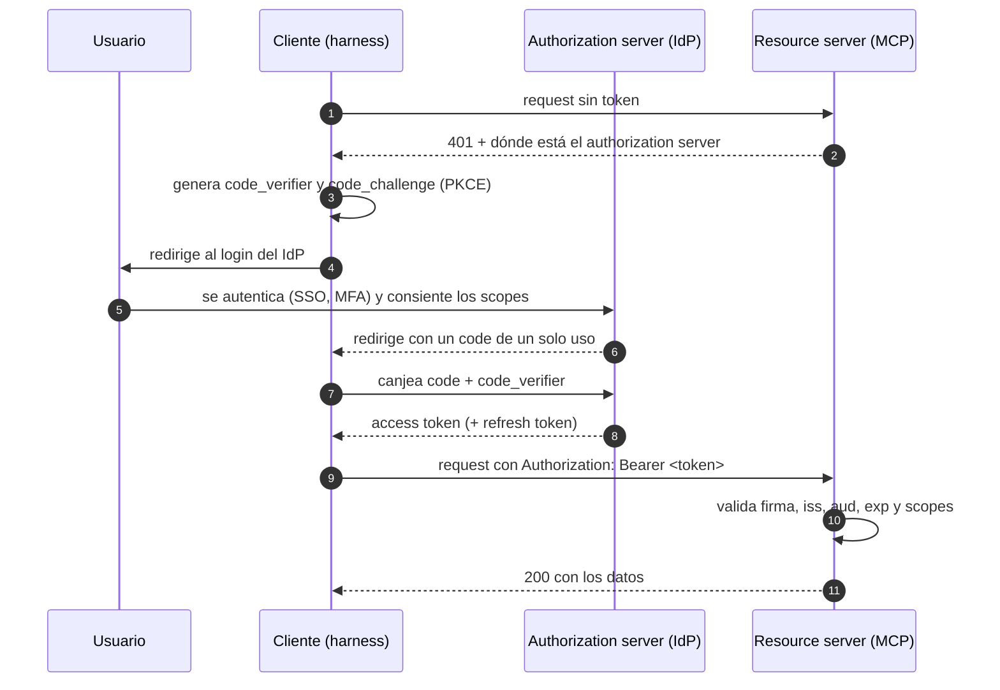

# 02 · HTTP, APIs, JSON-RPC y OAuth

Este capítulo es la base sobre la que se apoyan MCP, function calling y toda la gobernanza de identidad. Si lo salteás, el capítulo 06 se convierte en memorizar nombres de campos sin entender por qué están ahí.

Vas a ver que ya sabés más de lo que creés: **AWS es una gigantesca colección de APIs HTTP**. Cada `aws s3 ls` es un request HTTP firmado. Lo que falta es hacer explícito lo que la CLI te esconde.

## 1. Una API es un contrato

### Concepto

Una **API** (Application Programming Interface) es un contrato entre dos programas: *"si me mandás un mensaje con esta forma, te respondo con esta otra forma"*. El que pide es el **cliente** y el que responde es el **servidor**. El contrato define:

- **Qué operaciones existen** (consultar ventas, crear un pedido).
- **Qué datos recibe y devuelve cada una**, y en qué formato.
- **Cómo te identificás** (autenticación).
- **Qué pasa cuando algo falla** (errores).

### Por qué importa para IA

Un modelo de lenguaje, por sí solo, solo produce texto. Todo lo que un agente **hace** en el mundo (consultar una base, mandar un mail, crear un ticket) es, al final, **una llamada a una API**. MCP es, literalmente, una API estandarizada para que los agentes consuman otras APIs.

## 2. HTTP: el transporte de casi todo

HTTP es un protocolo de **request/response** sobre TCP (y TLS cuando es HTTPS). El cliente abre una conexión, manda un request y el servidor devuelve una response.

### Anatomía de un request

```http
POST /v1/messages HTTP/1.1                  ← método + path + versión
Host: api.anthropic.com                     ← headers: metadata del request
Content-Type: application/json
x-api-key: sk-ant-...
anthropic-version: 2023-06-01

{"model": "claude-...", "max_tokens": 256,  ← body: el contenido
 "messages": [{"role": "user", "content": "Hola"}]}
```

| Parte | Qué es | Ejemplo |
|---|---|---|
| **Método** | El verbo: qué tipo de operación | `GET` leer, `POST` crear o ejecutar, `PUT`/`PATCH` modificar, `DELETE` borrar |
| **Path** | Qué recurso o endpoint | `/v1/messages`, `/mcp` |
| **Headers** | Metadata clave-valor: formato, autenticación, versión, trazas | `Authorization: Bearer eyJ...` |
| **Body** | El contenido, típicamente JSON | `{"messages": [...]}` |

### Anatomía de una response

```http
HTTP/1.1 200 OK                             ← código de estado
Content-Type: application/json
request-id: req_011C...

{"id": "msg_01...", "content": [{"type": "text", "text": "¡Hola!"}], ...}
```

Los **códigos de estado** que vas a ver todo el tiempo con agentes:

| Código | Significado | En contexto de IA |
|---|---|---|
| `200` | OK | Respuesta normal |
| `400` | Request mal formado | Schema de tool inválido, parámetros incorrectos |
| `401` | No autenticado | Token faltante o vencido. **En MCP dispara el flujo OAuth** |
| `403` | Autenticado pero sin permiso | El usuario no tiene el scope necesario |
| `404` | No existe | Endpoint o recurso inexistente |
| `429` | Rate limit | Superaste la cuota de requests o tokens. Hay que reintentar con backoff |
| `500`/`502`/`503` | Error del servidor | Reintentable (con cuidado) |
| `529` | Overloaded (específico de Anthropic) | El proveedor está saturado. Reintentar |

!!! tip "Conexión con lo que ya sabés"
    Un ALB en AWS es exactamente esto: recibe requests HTTP, mira el path y los headers y los rutea a targets. Un WAF inspecciona los mismos headers y bodies. Todo lo que sabés de ALB, API Gateway y CloudFront aplica tal cual a servidores MCP remotos.

### Stateless vs stateful

HTTP es **stateless**: cada request es independiente y el servidor no recuerda el anterior. Cuando una aplicación necesita estado (un carrito, una sesión de login), lo agrega encima: una cookie o un header con un ID de sesión que el servidor busca en su memoria o en Redis.

Esto importa muchísimo para escalar: si el estado vive en la memoria de **una** instancia, el load balancer tiene que mandar siempre al mismo cliente a esa instancia (*sticky sessions*). Si cada request trae todo lo necesario, cualquier instancia puede atenderlo y escalás horizontalmente sin fricción.

**Guardá esta idea**: es exactamente el cambio que hizo MCP en la revisión 2026-07-28 (capítulo 06).

### Streaming: Server-Sent Events (SSE)

Un request HTTP normal devuelve la respuesta completa al final. Pero un modelo genera tokens de a uno y el usuario no quiere esperar 20 segundos mirando una pantalla vacía. La solución es **streaming**: el servidor mantiene la response abierta y va mandando fragmentos.

**SSE** es el formato estándar para esto: la response tiene `Content-Type: text/event-stream` y el body es una secuencia de eventos:

```text
event: content_block_delta
data: {"type":"content_block_delta","delta":{"type":"text_delta","text":"Hola"}}

event: content_block_delta
data: {"type":"content_block_delta","delta":{"type":"text_delta","text":", ¿cómo"}}

event: message_stop
data: {"type":"message_stop"}
```

Las APIs de modelos usan SSE para el streaming de tokens, y MCP lo usa opcionalmente para respuestas largas.

## 3. JSON y JSON Schema

### JSON

El formato de datos universal de las APIs web. Seis tipos: objeto `{}`, array `[]`, string, número, booleano y `null`.

```json
{
  "cliente": "ACME SA",
  "campania": "2025/26",
  "toneladas": 1520.5,
  "confirmado": true,
  "productos": ["soja", "maíz"],
  "observaciones": null
}
```

### JSON Schema: el contrato de los datos

**JSON Schema** es un JSON que describe la forma que debe tener otro JSON. Es **la pieza más importante de este capítulo para agentes**, porque así se define cada tool: el modelo lee el schema para saber qué argumentos generar, y el harness lo usa para validar lo que el modelo generó.

```json
{
  "type": "object",
  "properties": {
    "cliente_id": {
      "type": "string",
      "description": "Código de cliente de 6 dígitos, ej. '004512'"
    },
    "desde": { "type": "string", "format": "date" },
    "hasta": { "type": "string", "format": "date" },
    "producto": { "type": "string", "enum": ["soja", "maiz", "trigo", "girasol"] }
  },
  "required": ["cliente_id", "desde", "hasta"],
  "additionalProperties": false
}
```

Fijate en tres cosas:

1. **`description`** no es decoración: es texto que **el modelo lee** para decidir qué poner. Una buena descripción con ejemplo reduce errores más que cualquier otra cosa.
2. **`enum`** restringe los valores posibles. El modelo no puede inventar "sorgo" si no está en la lista.
3. **`required`** y **`additionalProperties: false`** hacen el contrato estricto.

## 4. Estilos de API: REST vs RPC

Hay dos filosofías para diseñar APIs.

### REST: orientado a recursos

Modelás **sustantivos** (recursos) y usás los métodos HTTP como verbos:

```http
GET    /clientes/004512/ventas?desde=2025-07-01   ← leer ventas de un cliente
POST   /pedidos                                    ← crear un pedido
DELETE /pedidos/88123                              ← borrar un pedido
```

La operación se deduce de **método + path**. Es lo más común en APIs públicas. Se documenta con **OpenAPI** (antes Swagger): un archivo YAML/JSON que describe todos los endpoints, parámetros y responses. **OData**, que vas a ver en SAP, es una variante de REST estandarizada para consultar datos con filtros en la URL (`$filter`, `$select`, `$top`).

### RPC: orientado a acciones

Modelás **verbos** (procedimientos) y todo va, típicamente, al mismo endpoint:

```http
POST /rpc
{"method": "ventas.consultar", "params": {"cliente_id": "004512"}}
```

La operación va **dentro del body**. Es "llamar a una función remota" (RPC = Remote Procedure Call).

### Por qué MCP eligió RPC

Un agente piensa en **acciones** ("consultá las ventas", "creá el ticket"), no en recursos HTTP. Y MCP necesita funcionar sobre transportes que **no son HTTP** (stdio, un pipe entre procesos). RPC con el método en el body es independiente del transporte; REST depende de HTTP. Por eso MCP usa **JSON-RPC 2.0**.

## 5. JSON-RPC 2.0: el idioma de MCP

JSON-RPC es una especificación mínima (cabe en dos páginas) para hacer RPC con JSON. Tiene cuatro tipos de mensaje.

### Request: "ejecutá esto y respondeme"

```json
{
  "jsonrpc": "2.0",
  "id": 7,
  "method": "tools/call",
  "params": { "name": "get_ventas", "arguments": { "cliente_id": "004512" } }
}
```

- `jsonrpc`: siempre `"2.0"`.
- `id`: identificador que elige el cliente. **La respuesta trae el mismo `id`**, y así se emparejan pedidos y respuestas cuando hay varios en vuelo.
- `method`: qué procedimiento.
- `params`: argumentos.

### Response exitosa

```json
{ "jsonrpc": "2.0", "id": 7, "result": { "content": [{ "type": "text", "text": "..." }] } }
```

### Response de error

```json
{ "jsonrpc": "2.0", "id": 7, "error": { "code": -32602, "message": "Invalid params: cliente_id" } }
```

Códigos estándar: `-32700` JSON inválido, `-32600` request inválido, `-32601` método inexistente, `-32602` parámetros inválidos, `-32603` error interno. Los protocolos que se montan encima (como MCP) definen códigos propios.

### Notification: "enterate, no me respondas"

```json
{ "jsonrpc": "2.0", "method": "notifications/tools/list_changed" }
```

**No tiene `id`**, así que nadie responde. Se usa para avisar eventos.

!!! note "Protocolo vs transporte"
    JSON-RPC define **el formato de los mensajes**, no cómo viajan. Pueden ir por HTTP, por un WebSocket o escritos línea por línea en el stdin de un proceso. MCP aprovecha exactamente esto: el mismo mensaje viaja por **stdio** (local) o por **HTTP** (remoto).

## 6. Autenticación y autorización

Dos preguntas distintas que la gente mezcla todo el tiempo:

- **Autenticación (AuthN):** ¿quién sos?
- **Autorización (AuthZ):** ¿qué podés hacer?

### API keys

Un string secreto que mandás en un header (`x-api-key: sk-ant-...`). Es simple, pero:

- Identifica **una aplicación**, no a un usuario.
- No vence salvo que la rotes.
- Si se filtra, sirve hasta que alguien la revoque.

Sirve para máquina a máquina en casos simples. **No sirve para saber qué usuario humano está detrás del agente.**

### Bearer tokens y JWT

Un **bearer token** es un token que se manda como `Authorization: Bearer <token>`. "Bearer" significa *portador*: quien lo tiene, lo usa. El formato más común es **JWT** (JSON Web Token): tres partes en base64 separadas por puntos, `header.payload.firma`.

El payload decodificado de un token de Entra ID se ve así:

```json
{
  "iss": "https://login.microsoftonline.com/<tenant-id>/v2.0",
  "sub": "AAAAAAAAAAAAAAAAAAAAAIkzqFVrSaSaFHy782bbtaQ",
  "aud": "api://agro-sales-mcp",
  "exp": 1790000000,
  "scp": "ventas.read",
  "roles": ["Comercial.Zona.Norte"],
  "preferred_username": "ana.perez@agrocorp.com"
}
```

| Claim | Significado | Por qué te importa |
|---|---|---|
| `iss` | Issuer: quién emitió el token | Validás que sea **tu** IdP |
| `sub` | Subject: a quién representa | La identidad estable del usuario |
| `aud` | Audience: **para quién** fue emitido | Tu servidor debe rechazar tokens emitidos para otro. Es la defensa contra reutilizar tokens |
| `exp` | Vencimiento | Tokens cortos (minutos u horas) limitan el daño de una fuga |
| `scp` / `roles` | Permisos | Lo que usás para autorizar |

El servidor **valida la firma** con las claves públicas del IdP (publicadas en un endpoint **JWKS**), así que no necesita llamar al IdP en cada request. Es verificación local, rápida y stateless.

### OAuth 2.0 / 2.1: delegación de acceso

OAuth resuelve este problema: *"quiero que la aplicación X acceda a mis datos en el sistema Y, sin darle mi contraseña"*. Tiene cuatro roles:

| Rol | Qué es | En un escenario de agentes |
|---|---|---|
| **Resource owner** | El dueño de los datos | El usuario humano |
| **Client** | La app que quiere acceder | El harness (ChatGPT, Claude, tu agente) |
| **Authorization server** | Emite tokens | Tu IdP (Entra ID, Okta, Cognito) |
| **Resource server** | Tiene los datos y valida tokens | **Tu servidor MCP** |

OAuth 2.1 consolida las buenas prácticas de 2.0 (PKCE obligatorio, sin flujo implícito). Es lo que exige la especificación de MCP.

#### Flujo authorization code + PKCE (usuario delegando)

Es el flujo que ocurre cuando conectás un servidor MCP remoto en Claude o ChatGPT y se abre una ventana de login:



**PKCE** (Proof Key for Code Exchange) evita que alguien que intercepte el `code` pueda canjearlo: solo quien generó el `code_verifier` original puede completar el canje.

#### Client credentials (máquina a máquina)

Sin usuario. La aplicación se autentica con su propio `client_id` + `client_secret` y recibe un token que la representa **a ella**. Es lo que tenés cuando un sistema (por ejemplo, un data warehouse) solo expone credenciales técnicas.

!!! warning "La trampa de client credentials"
    Si tu servidor MCP accede a los datos con client credentials, **la fuente de datos no sabe qué usuario está detrás**. Toda la autorización por usuario tiene que ocurrir en tu servidor MCP, antes de llamar. Es viable, pero la responsabilidad de no filtrar datos pasa completa a tu código. Capítulo 10.

#### Token exchange / On-Behalf-Of (propagación de identidad)

Tu servidor MCP recibe el token del usuario (audiencia: el MCP) y necesita llamar a otra API **en nombre del mismo usuario**. No puede reenviar el mismo token, porque la audiencia no coincide y sería un antipatrón de seguridad. Entonces lo **intercambia** en el IdP por un token nuevo con la audiencia de la API destino, que sigue representando al mismo usuario.

- Estándar: **RFC 8693 (Token Exchange)**.
- En Entra ID: flujo **On-Behalf-Of (OBO)**.

Es el mecanismo que permite que la identidad del usuario llegue desde el chat hasta la fila de la base.

### OIDC vs OAuth

- **OAuth** es sobre **autorización**: obtener un access token para acceder a algo.
- **OpenID Connect (OIDC)** es una capa encima de OAuth para **autenticación**: agrega un **ID token** que dice quién es el usuario.

El SSO corporativo de "Iniciar sesión con Microsoft" es OIDC.

### Traducción a tu mundo AWS

| Concepto de identidad web | Equivalente AWS que ya manejás |
|---|---|
| Access token de corta vida | Credenciales temporales de STS |
| Token exchange / OBO | `sts:AssumeRole` encadenado |
| `aud` del token | `Principal` y condiciones en una trust policy |
| Scopes / roles del token | Permisos de la policy del rol asumido |
| Client credentials | Access key de un IAM user (con los mismos riesgos) |
| JWKS / validación local de firma | Firma SigV4, que el servicio valida sin consultarte |
| Federación OIDC | IAM Identity Provider para GitHub Actions |

Si entendés cómo GitHub Actions asume un rol en AWS vía OIDC sin guardar access keys, ya entendés el 80% de cómo debería autenticarse un agente contra tus sistemas.

## 7. Resiliencia: lo que toda llamada a API necesita

Un agente hace decenas de llamadas por tarea. Cada una puede fallar.

| Mecanismo | Qué hace | Dónde aplica en agentes |
|---|---|---|
| **Timeout** | Corta una llamada que tarda demasiado | Tool calls a sistemas lentos; sin timeout, el loop se cuelga |
| **Retry con backoff exponencial + jitter** | Reintenta esperando 1s, 2s, 4s… con aleatoriedad | `429` y `529` del modelo, `503` de tools |
| **Idempotencia** | Ejecutar dos veces tiene el mismo efecto que una | **Crítico en tools de escritura**: si el modelo reintenta "crear pedido", no querés dos pedidos. Se resuelve con una *idempotency key* |
| **Rate limiting** | Limita requests por unidad de tiempo | En el gateway, por usuario y por agente |
| **Circuit breaker** | Deja de llamar a un servicio que está fallando | Evita que el agente martille un sistema caído |

## Recall

??? question "¿Por qué un servidor MCP debe validar el claim `aud` del token, y qué ataque evita?"
    Porque `aud` dice **para quién fue emitido** el token. Sin validarlo, un token que el usuario obtuvo para *otra* aplicación (quizás maliciosa o comprometida) serviría para acceder a tu servidor. Esa otra app podría reutilizar el token del usuario contra tu MCP. Validar `aud` garantiza que el token fue emitido específicamente para tu servidor. Es la misma lógica que la trust policy de un rol IAM: no cualquiera puede asumirlo.

??? question "Tenés que diseñar la tool `crear_orden_compra`. ¿Qué dos propiedades del capítulo le exigís y por qué?"
    1. **Idempotencia**, con una idempotency key generada por el harness por intención de acción. Los modelos y los harness reintentan, y los timeouts dejan en duda si la primera llamada se ejecutó. Sin idempotencia, duplicás órdenes.
    2. **Autorización con la identidad del usuario** (token delegado, no una service account), más confirmación humana, porque es una acción con efectos que no se puede deshacer.

??? question "¿Por qué JSON-RPC y no REST para MCP? Dá dos razones."
    1. **Independencia del transporte:** en JSON-RPC el método va en el body, así que el mismo mensaje funciona por stdio (sin HTTP) y por HTTP. REST depende de los verbos y paths de HTTP.
    2. **Modelo mental de acciones:** un agente invoca operaciones (`tools/call`), no manipula recursos. RPC mapea 1:1 con "llamar a una función".

??? question "Explicá con tus palabras la diferencia entre client credentials y on-behalf-of, y cuál necesitás para que el usuario A no vea los datos del usuario B."
    **Client credentials** produce un token que representa a la **aplicación**: todos los usuarios comparten la misma identidad ante la fuente de datos. **On-behalf-of** produce un token que representa **al usuario**, intercambiado a partir de su token original. Para que la fuente de datos filtre por usuario, necesitás OBO (o, si la fuente no conoce usuarios, un filtro obligatorio en tu servidor MCP derivado del token del usuario).
