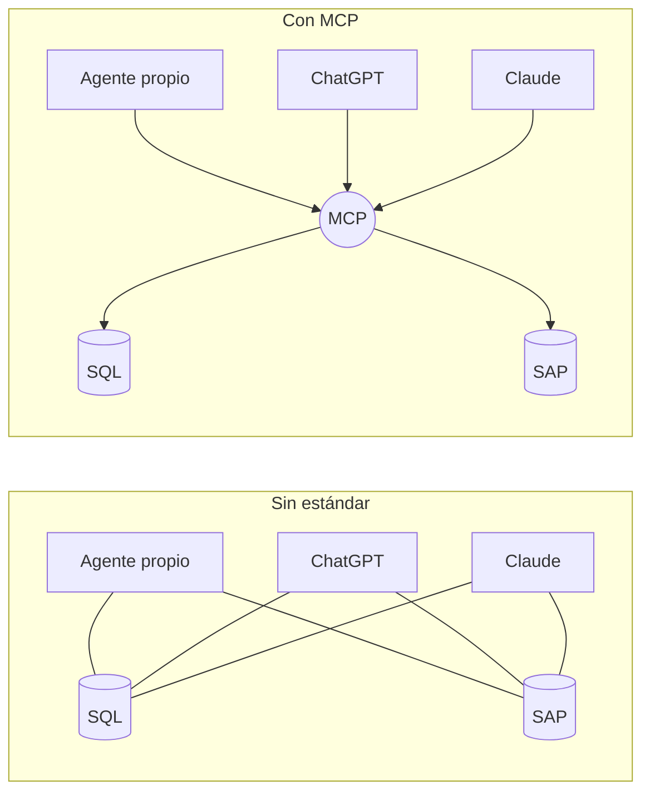

# 03 · Del function calling al agent loop

## Concepto

**Function calling** (o *tool use*) es la capacidad del modelo de responder, en lugar de texto, con **una solicitud estructurada para ejecutar una función**: nombre + argumentos en JSON que cumplen un schema.

El modelo **no ejecuta** nada. Solo escribe "quiero que se llame `get_ventas` con estos argumentos". Quien ejecuta es tu código. El **agent loop** es repetir eso hasta terminar.

## Por qué existe

Antes del function calling, para que un modelo "usara herramientas" había que pedirle que escribiera algo como `ACCIÓN: buscar("soja")` y parsear el texto con regex. Era frágil: el modelo variaba el formato y los argumentos llegaban mal.

Function calling formaliza el contrato: vos declarás las tools con JSON Schema, el modelo fue **entrenado** para emitir llamadas que cumplen ese schema, y la API te las devuelve como bloques estructurados, no como texto libre.

## Cómo funciona: el intercambio real

Vamos a ver los requests HTTP reales contra la Messages API de Anthropic. Con Bedrock o con OpenAI la forma cambia un poco, pero la mecánica es idéntica.

### Paso 1: el harness declara las tools y manda la pregunta

```json
POST /v1/messages
{
  "model": "claude-...",
  "max_tokens": 1024,
  "system": "Sos el asistente comercial de AgroCorp. Nunca estimes cifras: consultalas.",
  "tools": [
    {
      "name": "get_ventas",
      "description": "Devuelve toneladas vendidas a un cliente en un rango de fechas.",
      "input_schema": {
        "type": "object",
        "properties": {
          "cliente_id": { "type": "string", "description": "Código de 6 dígitos" },
          "desde": { "type": "string", "format": "date" },
          "hasta": { "type": "string", "format": "date" }
        },
        "required": ["cliente_id", "desde", "hasta"]
      }
    }
  ],
  "messages": [
    { "role": "user", "content": "¿Cuánto le vendimos al cliente 004512 en agosto 2026?" }
  ]
}
```

### Paso 2: el modelo responde pidiendo una tool

```json
{
  "stop_reason": "tool_use",
  "content": [
    { "type": "text", "text": "Consulto las ventas de agosto." },
    {
      "type": "tool_use",
      "id": "toolu_01A",
      "name": "get_ventas",
      "input": { "cliente_id": "004512", "desde": "2026-08-01", "hasta": "2026-08-31" }
    }
  ]
}
```

`stop_reason: "tool_use"` es la señal: **el modelo se detuvo porque necesita que alguien ejecute algo**. Fijate que transformó "agosto 2026" en fechas concretas: ese razonamiento es el valor que aporta el modelo.

### Paso 3: el harness ejecuta y devuelve el resultado

Tu código ejecuta `get_ventas(...)` (una query, una llamada a API o un servidor MCP) y manda **todo el historial** más el resultado:

```json
POST /v1/messages
{
  "model": "claude-...",
  "system": "...",
  "tools": [ ... las mismas ... ],
  "messages": [
    { "role": "user", "content": "¿Cuánto le vendimos al cliente 004512 en agosto 2026?" },
    { "role": "assistant", "content": [ ...el bloque tool_use del paso 2... ] },
    {
      "role": "user",
      "content": [
        { "type": "tool_result", "tool_use_id": "toolu_01A", "content": "{\"toneladas\": 1520.5, \"operaciones\": 7}" }
      ]
    }
  ]
}
```

### Paso 4: el modelo responde al usuario

```json
{
  "stop_reason": "end_turn",
  "content": [{ "type": "text", "text": "En agosto 2026 se le vendieron 1.520,5 tn al cliente 004512, en 7 operaciones." }]
}
```

`stop_reason: "end_turn"`: terminó.

!!! note "Observá el costo"
    En el paso 3 se reenvió **todo**: system prompt, definiciones de tools, pregunta original y respuesta anterior. Cada vuelta del loop paga de nuevo todo el contexto acumulado. Por eso un agente con 15 tool calls cuesta mucho más que 15 veces una pregunta simple, y por eso el **prompt caching** (capítulo 04) es fundamental.

## El agent loop mínimo

Este es un harness completo y funcional en unas 40 líneas. **Leelo entero**: todo framework del mercado es esto con más capas encima.

```python
import json
import anthropic

client = anthropic.Anthropic()  # lee ANTHROPIC_API_KEY del entorno

# --- Tools: implementación local (sin MCP todavía) ---
def get_ventas(cliente_id: str, desde: str, hasta: str) -> dict:
    # En la vida real: query parametrizada a la base, con la identidad del usuario
    return {"toneladas": 1520.5, "operaciones": 7}

TOOLS_IMPL = {"get_ventas": get_ventas}

TOOLS_SCHEMA = [{
    "name": "get_ventas",
    "description": "Devuelve toneladas vendidas a un cliente en un rango de fechas.",
    "input_schema": {
        "type": "object",
        "properties": {
            "cliente_id": {"type": "string"},
            "desde": {"type": "string", "format": "date"},
            "hasta": {"type": "string", "format": "date"},
        },
        "required": ["cliente_id", "desde", "hasta"],
    },
}]

SYSTEM = "Sos el asistente comercial de AgroCorp. Nunca estimes cifras: consultalas."
MAX_TURNS = 10  # límite duro: el harness garantiza, el prompt no

def run_agent(pregunta: str) -> str:
    messages = [{"role": "user", "content": pregunta}]
    for _ in range(MAX_TURNS):
        resp = client.messages.create(
            model="claude-...", max_tokens=1024,
            system=SYSTEM, tools=TOOLS_SCHEMA, messages=messages,
        )
        messages.append({"role": "assistant", "content": resp.content})

        if resp.stop_reason != "tool_use":
            return "".join(b.text for b in resp.content if b.type == "text")

        resultados = []
        for bloque in resp.content:
            if bloque.type == "tool_use":
                fn = TOOLS_IMPL.get(bloque.name)       # allowlist: solo lo registrado
                try:
                    salida = fn(**bloque.input) if fn else {"error": "tool no permitida"}
                except Exception as e:
                    salida = {"error": str(e)}          # el error vuelve al modelo
                resultados.append({
                    "type": "tool_result",
                    "tool_use_id": bloque.id,
                    "content": json.dumps(salida),
                })
        messages.append({"role": "user", "content": resultados})
    return "Se alcanzó el límite de iteraciones."

print(run_agent("¿Cuánto le vendimos al cliente 004512 en agosto 2026?"))
```

Lo que hace este código, mapeado a responsabilidades del harness:

| Línea o bloque | Responsabilidad del harness |
|---|---|
| `messages = [...]` y los `append` | **Gestión de estado** (el historial) |
| `system=SYSTEM, tools=TOOLS_SCHEMA` | **Ensamblado de contexto** |
| `for _ in range(MAX_TURNS)` | **Control del loop y límite de costo** |
| `TOOLS_IMPL.get(...)` | **Allowlist de tools** (permisos) |
| `try/except` y el error devuelto | **Manejo de errores**: el modelo ve el error y puede corregirse |
| `stop_reason != "tool_use"` | **Condición de terminación** |

## Lo que le falta para producción

Todo lo que agregan los frameworks y los runtimes gestionados:

| Falta | Por qué importa | Capítulo |
|---|---|---|
| Streaming de tokens al usuario | UX: nadie espera 30 segundos mirando la nada | 05 |
| Compactación de contexto | Conversaciones largas revientan la ventana | 04 |
| Prompt caching | Sin caché, cada vuelta paga todo el contexto completo | 04 |
| Tools vía MCP en vez de funciones locales | Reutilización entre agentes y equipos | 06 |
| Identidad del usuario propagada a las tools | Sin esto no hay autorización por usuario | 10 |
| Aprobación humana antes de acciones con efectos | Escrituras, envíos, pagos | 10 |
| Tool calls en paralelo | El modelo puede pedir varias tools a la vez; ejecutarlas en serie es lento | 05 |
| Reintentos con backoff ante `429`/`529` | Los proveedores se saturan | 02 |
| Persistencia de la sesión | Si el proceso muere a mitad de tarea, se pierde todo | 05 |
| Tracing de cada paso | Sin esto no podés depurar ni medir costos | 12 |
| Guardrails de entrada y salida | PII, injection | 12 |

## El problema N×M: por qué aparece MCP

Con el código de arriba, **cada tool está atada a este harness**. Ahora imaginá la organización:

- 4 harness distintos: tu agente propio, Claude, ChatGPT y el IDE de los developers.
- 10 sistemas: SQL Server, SAP, Jira, SharePoint, GitHub, etc.

Sin estándar, necesitás **4 × 10 = 40 integraciones**, cada una con su formato de schema, su auth y sus bugs. Con MCP, cada sistema expone **un** servidor y cada harness implementa **un** cliente: **4 + 10 = 14 piezas**.



Es exactamente el mismo argumento que ODBC para bases de datos, USB para periféricos o el Language Server Protocol para editores de código (del que MCP tomó inspiración directa).

## Antipatrones

| Antipatrón | Consecuencia |
|---|---|
| No limitar iteraciones | Un loop infinito es una factura infinita |
| Tirar excepción y cortar el loop cuando una tool falla | El modelo podría haberse corregido con el mensaje de error |
| Devolver resultados enormes de tools (10.000 filas) | Se llena la ventana, sube el costo y baja la calidad. Paginá y resumí en la tool |
| Descripciones de tools vagas ("obtiene datos") | El modelo elige mal la tool o genera argumentos incorrectos |
| Ejecutar lo que el modelo pide sin validar contra el schema | Argumentos malformados llegan a tu base |

## Recall

??? question "¿Qué significa `stop_reason: tool_use` y quién actúa a continuación?"
    Que el modelo **terminó su turno pidiendo que se ejecute una o más tools**. A continuación actúa el **harness**: ejecuta cada `tool_use`, arma los `tool_result` con el mismo `tool_use_id` y vuelve a llamar al modelo con todo el historial. El modelo nunca ejecuta nada.

??? question "¿Por qué el costo de un agente crece más rápido que linealmente con la cantidad de tool calls?"
    Porque **cada vuelta reenvía todo el contexto acumulado**: system prompt, tools, historial y todos los resultados anteriores. Si cada vuelta agrega k tokens, la vuelta n envía aproximadamente n·k tokens, y el total después de N vueltas es ~k·N²/2. Es **cuadrático**. El prompt caching mitiga el costo del prefijo repetido, pero no el crecimiento de la ventana.

??? question "Con 6 harness y 25 sistemas, ¿cuántas integraciones necesitás sin estándar y cuántas piezas con MCP?"
    Sin estándar: 6 × 25 = **150**. Con MCP: 6 clientes + 25 servidores = **31**. Y en la práctica los clientes ya vienen hechos en los harness comerciales, así que construís los **25 servidores**, y solo los que no existan ya en la comunidad.
