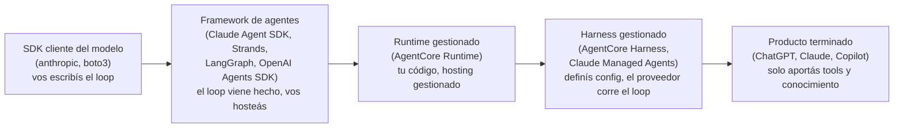
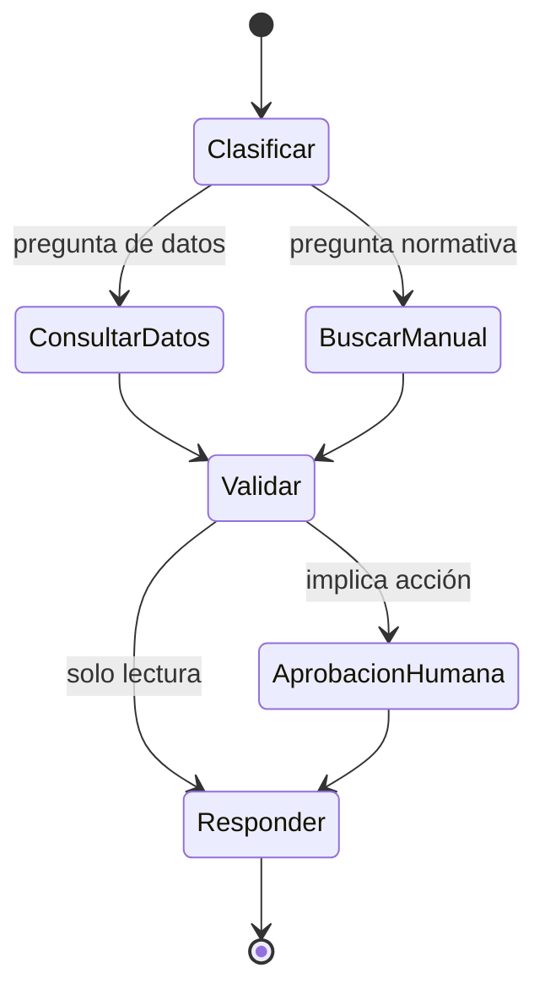
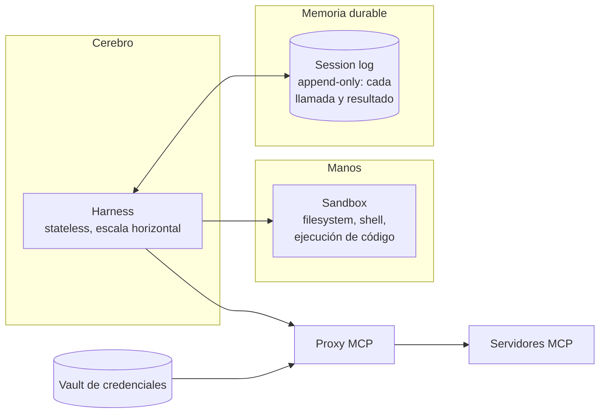

# 05 · El harness: frameworks y runtimes

## Concepto

El **harness** es el programa que convierte un modelo en un agente. Ejecuta el loop, ensambla el contexto, ejecuta las tools, maneja el estado, aplica permisos y se recupera de fallos.

AWS lo resumió bien al lanzar su harness gestionado: *si el modelo es el cerebro, el harness es el cuerpo*. Y la industria llegó a la misma conclusión por caminos distintos: **el harness influye en la calidad del agente tanto como el modelo.** El mismo modelo con un harness mediocre rinde mucho peor que con uno bueno.

## Responsabilidades de un harness

| Responsabilidad | Qué implica | Si falta… |
|---|---|---|
| **Loop** | Llamar al modelo, detectar `tool_use`, ejecutar y repetir | No hay agente |
| **Ensamblado de contexto** | System prompt, tools, skills, RAG, memoria, historial, en el orden correcto | Respuestas pobres, caché roto |
| **Ejecución de tools** | Locales, MCP o código en sandbox, con timeouts y en paralelo | Lentitud, cuelgues |
| **Permisos** | Allowlist de tools, aprobación humana, modos (solo lectura, auto) | Acciones no deseadas |
| **Estado y sesión** | Historial, archivos de trabajo, checkpoints | Se pierde el trabajo si el proceso muere |
| **Gestión de ventana** | Compactación, limpieza de resultados viejos | La sesión revienta por tamaño |
| **Resiliencia** | Retries con backoff, fallback de modelo | Errores transitorios matan tareas |
| **Streaming** | Mandar tokens y eventos al frontend a medida que llegan | Mala UX |
| **Identidad** | Recibir la identidad del usuario y propagarla a las tools | No hay autorización por usuario |
| **Observabilidad** | Emitir traces de cada paso | No se puede depurar ni medir |
| **Sandboxing** | Aislar la ejecución de código que genera el modelo | Ejecución arbitraria en tu infra |

## El espectro build vs buy



**A la izquierda:** más control, más trabajo, menos lock-in de plataforma.
**A la derecha:** menos trabajo, menos control, más lock-in y menos diferenciación.

No hay respuesta universal. La pregunta correcta es: **¿qué parte de esta cadena es mi diferencial?** Si tu diferencial son los datos y las tools, no tiene sentido mantener un loop propio. Si tu diferencial es el comportamiento del agente (flujos específicos, control fino), sí.

## Frameworks: con qué se escribe el loop

### Claude Agent SDK (Anthropic)

- **Qué es:** el harness de Claude Code extraído como librería (Python y TypeScript).
- **Filosofía:** agente autónomo con "computadora": filesystem, shell, búsqueda, edición. El modelo dirige el loop.
- **Trae:** loop, tools built-in (leer, editar, bash, grep, web), cliente MCP, subagentes, skills, hooks, compactación, permisos.
- **Modelo:** Claude (API de Anthropic, Bedrock o Vertex).
- **Cuándo:** agentes que trabajan sobre archivos y código, tareas largas y abiertas, o cuando querés el mismo comportamiento que Claude Code en tu propio servicio.

```python
# Ilustrativo: verificá nombres exactos contra la versión del SDK que instales
from claude_agent_sdk import query, ClaudeAgentOptions

options = ClaudeAgentOptions(
    system_prompt="Sos el asistente de datos comerciales de AgroCorp...",
    mcp_servers={
        "sales": {"type": "http", "url": "https://sales-mcp.internal/mcp",
                  "headers": {"Authorization": f"Bearer {user_token}"}},
    },
    allowed_tools=["mcp__sales__get_ventas", "mcp__sales__get_stock"],  # allowlist
    max_turns=10,
)

async for mensaje in query(prompt="Ventas del cliente 004512 en agosto", options=options):
    print(mensaje)
```

### Strands Agents (AWS, open source)

- **Qué es:** framework open source de AWS, *model-driven*: el modelo decide el flujo, el framework resuelve la plomería.
- **Trae:** loop, decorador `@tool`, cliente MCP, patrones multi-agente (grafos, swarms, agentes como tools), integración con OpenTelemetry.
- **Modelo:** agnóstico (Bedrock por defecto, también Anthropic, OpenAI, Ollama, etc.).
- **Dato importante:** el **AgentCore Harness gestionado corre sobre Strands**, y podés exportar su configuración a código Strands cuando necesitás más control.
- **Cuándo:** AWS-first, necesitás flexibilidad de modelos o pensás migrar a AgentCore.

```python
# Ilustrativo
from strands import Agent, tool
from strands.models import BedrockModel

@tool
def get_stock(planta: str) -> dict:
    """Devuelve el stock actual en toneladas por producto para una planta."""
    return {"soja": 12000, "maiz": 8400}

agent = Agent(
    model=BedrockModel(model_id="<id-del-modelo-claude-en-bedrock>"),
    system_prompt="Sos el asistente de datos comerciales de AgroCorp...",
    tools=[get_stock],
)
agent("¿Cuánto stock de soja hay en la planta Timbúes?")
```

### LangGraph (LangChain)

- **Qué es:** framework para modelar el agente como un **grafo de estados explícito**: nodos (pasos) y aristas (transiciones, incluso condicionales).
- **Filosofía:** *workflow-driven*. Vos definís la estructura y el modelo decide dentro de cada nodo.
- **Trae:** checkpoints persistentes (retomar una ejecución), *human-in-the-loop* en nodos definidos, time-travel debugging.
- **Cuándo:** procesos con pasos obligatorios y auditables (aprobaciones, compliance), cuando necesitás determinismo sobre el orden.



### Otros que vas a encontrar

| Framework | De quién | Nota |
|---|---|---|
| **OpenAI Agents SDK** | OpenAI | Agentes con *handoffs* entre agentes y guardrails. Liviano |
| **Google ADK** (Agent Development Kit) | Google | Se integra con Vertex AI Agent Engine |
| **Microsoft Agent Framework** | Microsoft | Sucesor de Semantic Kernel y AutoGen; se integra con Foundry |
| **CrewAI** | Comunidad | Multi-agente por "roles". Popular en demos |
| **LlamaIndex** | Comunidad | Fuerte en RAG y agentes sobre documentos |

### Cómo elegir framework

| Si necesitás… | Elegí |
|---|---|
| Agente autónomo sobre archivos y código, estilo Claude Code | Claude Agent SDK |
| AWS-first, flexibilidad de modelo, camino a AgentCore | Strands |
| Flujo con pasos obligatorios, checkpoints y aprobaciones | LangGraph |
| El caso es simple (un par de tools, un turno) | **Ningún framework**: el loop del capítulo 03 alcanza |

!!! tip "El framework es la decisión menos importante"
    Es la más discutida y la que menos impacta. Un framework se reemplaza en semanas. Las decisiones de identidad, datos, tools y evals te acompañan años. Si tus tools están en **servidores MCP**, cambiar de framework no te obliga a reescribirlas.

## Runtimes: dónde corre el proceso

| Runtime | Modelo de ejecución | Fortalezas | Límites |
|---|---|---|---|
| **Laptop** | Proceso local (Claude Code, Claude Desktop) | Cero infra, acceso a archivos locales | Sin gobernanza central, secretos en la máquina |
| **Lambda** | Función por invocación | Barato con tráfico bajo, escala a cero | Límite de 15 minutos, streaming limitado, sin estado entre invocaciones |
| **ECS Fargate / EKS** | Contenedor de larga vida | Control total, VPC, sidecars, sin límite de duración | Operás el escalado, el aislamiento entre sesiones y el estado |
| **AgentCore Runtime** | Tu contenedor, **una microVM por sesión** | Aislamiento fuerte entre usuarios, sesiones largas, se cobra el CPU activo y no el tiempo de espera del modelo | Lock-in de AWS; modelo de despliegue propio |
| **AgentCore Harness** | Definís el agente como configuración y AWS corre el loop (sobre Strands) | Sin código de orquestación, microVM con filesystem y shell por sesión | Menos control del loop |
| **Claude Managed Agents** | Harness en infraestructura de Anthropic; sandbox de Anthropic o **self-hosted** | Sesiones de horas, log de eventos durable, credenciales MCP en un vault fuera del sandbox | Solo Claude; el loop corre fuera de tu nube |
| **Microsoft Foundry Agent Service / Vertex AI Agent Engine** | Equivalentes en Azure y GCP | Integración con su ecosistema | Lock-in en su nube |

### ¿Por qué importa el aislamiento por sesión?

Si tu harness corre en un contenedor ECS que atiende a 50 usuarios a la vez y el agente puede **ejecutar código** o escribir archivos, un usuario podría leer los archivos de trabajo de otro, o una injection en la sesión de A podría afectar la de B. Opciones:

- **Agentes sin ejecución de código** (solo tools de API): el aislamiento de proceso compartido suele alcanzar, con cuidado del estado en memoria.
- **Agentes con ejecución de código:** una sandbox por sesión (microVM, contenedor efímero, gVisor). AgentCore Runtime y Managed Agents lo hacen por diseño.

### Separar el cerebro de las manos

La arquitectura que convergieron Anthropic (Managed Agents) y AWS (AgentCore) separa tres cosas:



- **El harness es stateless:** cualquier instancia puede retomar cualquier sesión leyendo el log. Si muere, otra continúa.
- **El sandbox es descartable:** ganado, no mascota (*cattle, not pets*).
- **Las credenciales no están ni en el harness ni en el sandbox:** un proxy las busca en un vault al llamar a un MCP. Una injection que tome el control del sandbox no puede robar tokens.

Es el mismo razonamiento que aplicás cuando separás cómputo stateless de estado en RDS o DynamoDB: **sacar el estado del proceso para poder tratar el proceso como descartable.**

## Claude Code, visto como harness

Para fijar todo con algo que usás:

| Capa | En Claude Code |
|---|---|
| Modelo | Remoto: API de Anthropic, o Bedrock/Vertex por configuración |
| Harness | El proceso de Claude Code (la versión web corre en un sandbox en la nube de Anthropic) |
| Framework | El mismo motor que se publica como Claude Agent SDK |
| Tools | Built-in (`Read`, `Edit`, `Bash`, `Grep`, `WebFetch`) + cliente MCP |
| Contexto persistente | `CLAUDE.md` de usuario y de proyecto, inyectados al iniciar |
| Gestión de ventana | Compactación automática |
| Extensiones | Subagentes, skills y **hooks** (código determinístico antes o después de cada tool) |
| Permisos | Allowlist y denylist en `settings.json`; modos de aprobación |

Ejemplo de "el prompt orienta, el harness garantiza" en Claude Code:

- **`CLAUDE.md`:** "Nunca ejecutes `terraform apply`; corré `terraform validate` después de cada cambio." → **orientación**.
- **`settings.json`:** `"deny": ["Bash(terraform apply:*)"]` → **garantía**.
- **Hook `PreToolUse`:** un script que bloquea cualquier comando que contenga `apply` o `destroy` → **garantía con lógica propia**.

## Antipatrones

| Antipatrón | Consecuencia |
|---|---|
| Harness en Lambda para sesiones conversacionales largas | Timeouts a los 15 minutos y estado perdido entre invocaciones |
| Estado de sesión en memoria del contenedor | Un deploy o un scale-in borra conversaciones en curso |
| Ejecución de código del agente en el mismo contenedor que atiende a todos | Una injection se convierte en ejecución arbitraria con acceso a todas las sesiones |
| Credenciales de tools en variables de entorno del harness | Si el modelo es inducido a imprimir su entorno, se filtran |
| Elegir framework por popularidad en redes | Deuda técnica sin razón |

## Recall

??? question "Tu equipo quiere hostear el agente en Lambda. ¿Qué preguntas hacés antes de aceptar?"
    1. **¿Cuánto dura una tarea?** Si puede superar los 15 minutos (el límite de Lambda), no sirve.
    2. **¿Dónde vive el estado de la sesión?** Lambda no guarda estado entre invocaciones: hay que externalizarlo (DynamoDB, S3).
    3. **¿Necesitamos streaming al usuario?** Es posible con response streaming, pero agrega complejidad.
    4. **¿El agente ejecuta código?** Entonces necesitás sandbox aparte.

    Lambda funciona bien para agentes **cortos, por eventos** (procesar un documento que llega a S3). Para conversaciones largas, ECS o AgentCore Runtime.

??? question "¿Qué ventaja de seguridad concreta tiene que las credenciales de MCP vivan en un vault accedido por un proxy, en lugar de en el harness?"
    Si una prompt injection logra que el agente ejecute código arbitrario o imprima su entorno, **no hay credenciales para robar**: ni el sandbox ni el proceso del harness las tienen. El proxy las inyecta en el request saliente al MCP y el modelo nunca las ve. Limita el radio de explosión de una injection exitosa.

??? question "Explicá con una analogía de AWS por qué el harness de Managed Agents o AgentCore es 'stateless' con un session log externo."
    Es el patrón de una aplicación web detrás de un ALB con autoscaling: las instancias EC2 o tasks de ECS son descartables y el estado vive en RDS o DynamoDB. Si una instancia muere, otra atiende el siguiente request leyendo el estado externo. Acá, el harness es la task descartable y el session log (append-only) es la base. Así el sistema sobrevive a crashes y escala horizontalmente.
