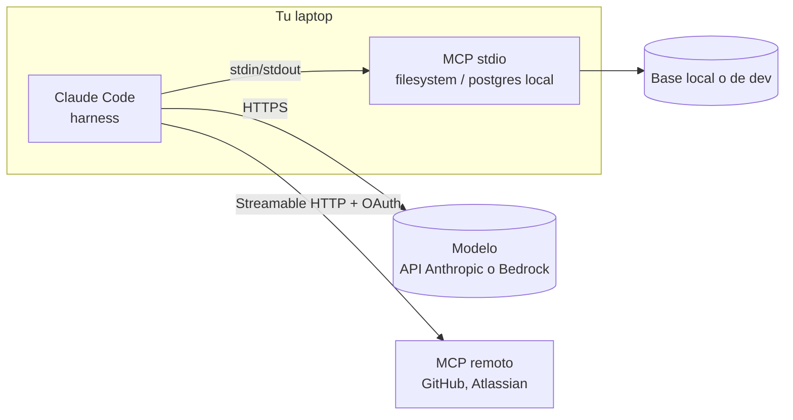
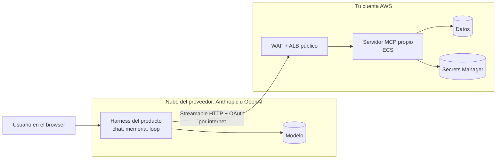
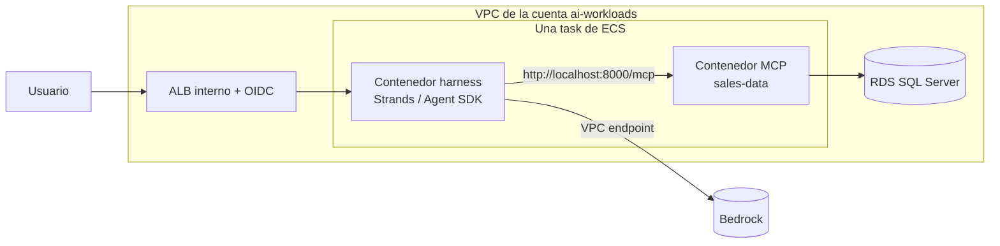
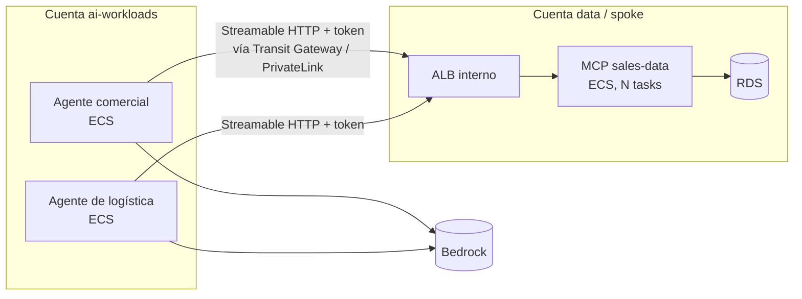
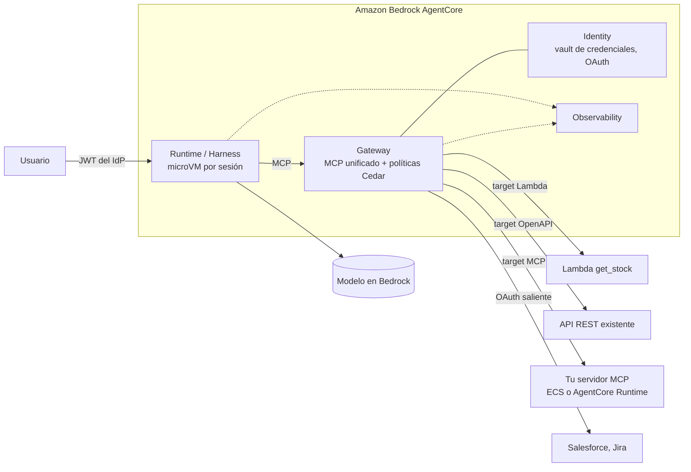
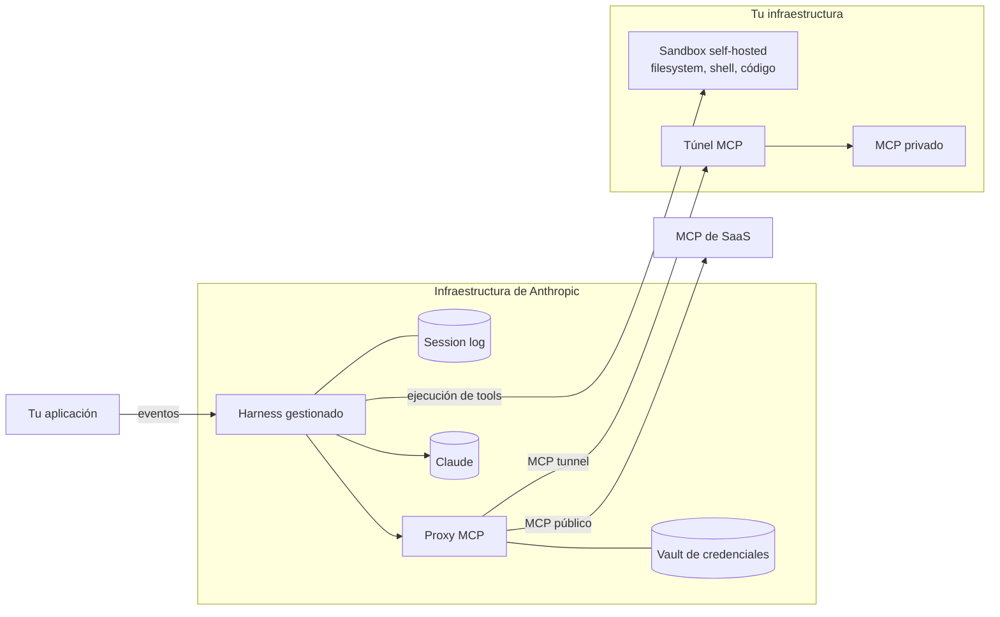
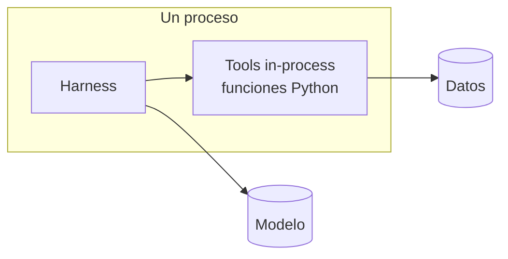
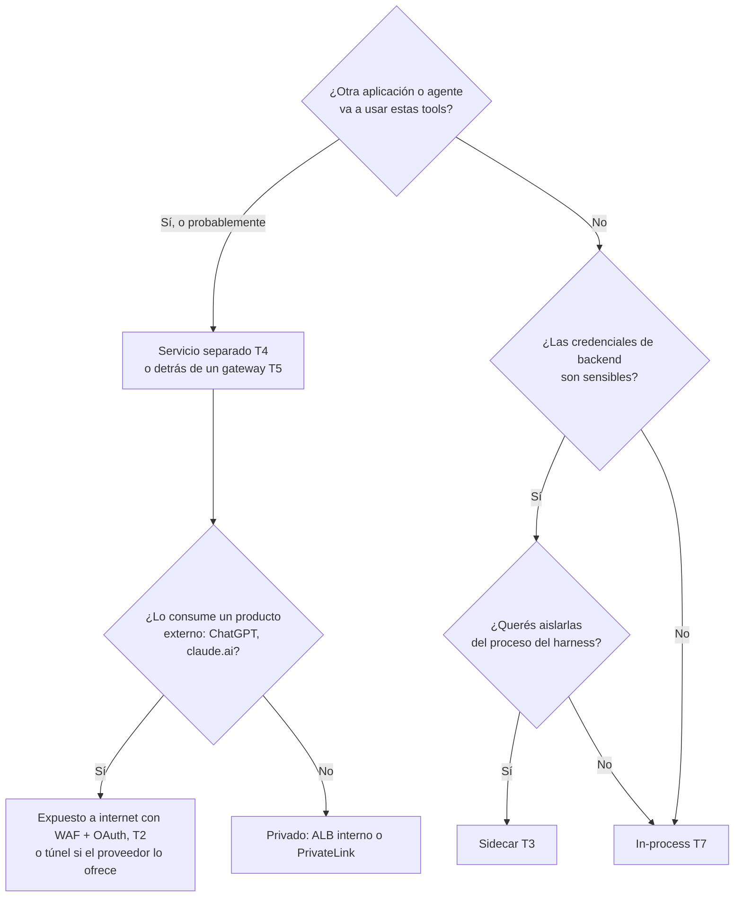

# 07 · Topologías reales: dónde corre cada cosa

## Concepto

Una **topología** es la respuesta concreta a *"¿en qué máquina, red y cuenta corre cada pieza, y quién guarda cada secreto?"*. Los mismos componentes (modelo, harness, cliente MCP, servidor MCP) se pueden ubicar de formas muy distintas, y cada ubicación cambia la seguridad, el costo, la latencia y quién opera qué.

Este capítulo recorre siete topologías reales, de la más simple a la más gobernada. En cada una hacete siempre las mismas cinco preguntas:

1. **¿Dónde corre el harness?**
2. **¿Dónde corre cada servidor MCP y cómo se comunica con el harness?**
3. **¿Dónde viven los secretos de backend?**
4. **¿Cómo llega la identidad del usuario hasta los datos?**
5. **¿Qué ve el proveedor del modelo?**

## T1 · Claude Code en tu laptop

| Pregunta | Respuesta |
|---|---|
| Harness | Proceso local en tu terminal |
| MCP | stdio como **subproceso de tu laptop**; remotos en la infra del vendor |
| Secretos | stdio: variables de entorno o archivos en tu laptop. Remotos: token OAuth en el keychain local |
| Identidad | Sos vos; el MCP stdio accede con las credenciales que le diste |
| Qué ve el proveedor del modelo | Todo lo que entra al contexto: código, resultados de tools |

**Cuándo sirve:** productividad individual de developers. **Qué no escala:** cada developer con sus secretos, sin auditoría central ni control de qué servidores se instalan.

## T2 · Harness del proveedor (claude.ai, ChatGPT) + tu MCP remoto

| Pregunta | Respuesta |
|---|---|
| Harness | **En la nube del proveedor.** No lo controlás |
| MCP | Tu servidor, en tu cuenta, **alcanzable desde internet** (el harness del proveedor tiene que poder llegar) |
| Secretos | Credenciales de backend en tu Secrets Manager. El proveedor guarda el token OAuth del usuario |
| Identidad | OAuth: el usuario se loguea contra tu IdP y el proveedor manda el token en cada llamada |
| Qué ve el proveedor | La conversación completa **y los resultados de tus tools** |

**Detalle crítico:** tu servidor MCP queda expuesto a internet. Por eso: WAF, validación estricta de tokens, rate limiting y, si el proveedor publica rangos de IP de salida, restricción por IP. Algunos proveedores ofrecen túneles para llegar a servidores privados; verificá disponibilidad para tu plan.

Esta es la topología de una **app de ChatGPT** o de un **conector personalizado de Claude**. El capítulo 08 la analiza en detalle.

## T3 · Harness propio en ECS con MCP como sidecar

| Pregunta | Respuesta |
|---|---|
| Harness | Contenedor en una task de ECS |
| MCP | **Otro contenedor en la misma task.** Comparten red (`localhost`), ciclo de vida y escalado |
| Secretos | En el contenedor MCP (rol de la task o secret inyectado); el harness no los necesita |
| Identidad | El ALB valida el login OIDC; el harness recibe el token y lo pasa al sidecar |
| Qué ve el proveedor | Con Bedrock: el modelo corre en AWS bajo tus términos, sin salir de la región |

**Ventajas:** latencia mínima, un solo deploy, sin auth entre harness y MCP (misma task). **Desventajas:** el MCP escala con el harness aunque no haga falta, y **ningún otro agente puede reutilizarlo**. Es MCP "por prolijidad" más que por reutilización.

**Cuándo sirve:** un agente, un equipo, y querés que las tools ya estén en MCP para el día que otro agente las necesite.

## T4 · Harness propio + MCP como servicio compartido

| Pregunta | Respuesta |
|---|---|
| Harness | Varios agentes, cada uno su servicio |
| MCP | **Servicio independiente**, idealmente en la cuenta dueña de los datos, detrás de un ALB interno |
| Secretos | Solo en el servicio MCP; los agentes nunca ven credenciales de la base |
| Identidad | Cada agente propaga el token del usuario; el MCP valida y autoriza |
| Red | Tráfico privado entre cuentas: Transit Gateway, VPC peering o **PrivateLink** (lo más limpio: expone solo el servicio, no la red) |

**Ventajas:** reutilización, escalado independiente, **el equipo dueño de los datos es dueño del MCP** (ownership claro), secretos en un solo lugar. **Desventajas:** un salto de red más y auth entre servicios.

**Esta es la topología objetivo para datos corporativos.** Encaja con un modelo hub-spoke: el MCP vive donde viven los datos.

## T5 · AgentCore: runtime, gateway e identidad gestionados

| Pregunta | Respuesta |
|---|---|
| Harness | **AgentCore Runtime** (tu código en una microVM por sesión) o **AgentCore Harness** (configuración, AWS corre el loop) |
| MCP | El agente habla con **un solo endpoint MCP: el Gateway**. El Gateway traduce hacia Lambdas, APIs OpenAPI, servidores MCP y SaaS |
| Secretos | **AgentCore Identity**: vault de credenciales y tokens OAuth salientes; el agente no los ve |
| Identidad | JWT del IdP al entrar; el Gateway aplica **políticas Cedar** por tool y por usuario |
| Qué ve el proveedor | Todo en AWS, bajo tus términos y región |

**La idea central:** el Gateway es un **MCP gateway**. Convierte APIs y Lambdas que ya tenés en tools MCP sin escribir un servidor, y centraliza autorización y auditoría. Es la versión gestionada de lo que en T4 construís a mano.

**Trade-off:** menos código y más gobernanza lista para usar, a cambio de lock-in en AWS y del modelo de precios por componente.

## T6 · Claude Managed Agents con sandbox propio y túnel MCP

| Pregunta | Respuesta |
|---|---|
| Harness | **En Anthropic**, stateless, con log de sesión durable |
| Ejecución de código | Por defecto en sandboxes de Anthropic; con **self-hosted sandboxes**, en tu infraestructura (archivos y red de salida no salen de tu perímetro) |
| MCP | Llamado por un **proxy** que toma credenciales de un **vault**; con **MCP tunnels** alcanza servidores privados sin exponerlos a internet |
| Secretos | Vault gestionado, fuera del harness y del sandbox |
| Qué ve el proveedor | Entradas y salidas de las tools (el modelo las necesita para razonar), aunque la ejecución sea en tu infra |

**Cuándo sirve:** tareas largas y autónomas (horas), con ejecución de código, cuando no querés operar el loop ni la persistencia de sesiones. **Límite:** solo Claude, y el loop corre fuera de tu nube.

## T7 · Tools in-process (sin transporte)

Algunos frameworks permiten definir un "servidor MCP" **dentro del mismo proceso** del harness (el Claude Agent SDK lo llama *SDK MCP server*), o directamente tools como funciones decoradas (`@tool` en Strands).

**Ventaja:** cero latencia de red, cero infraestructura. **Desventaja:** cero reutilización, y los secretos conviven con el harness. Es T3 llevado al extremo. Bueno para prototipos y para tools que genuinamente solo usa ese agente.

## Matriz comparativa

| | T1 Laptop | T2 Harness proveedor | T3 Sidecar | T4 Servicio compartido | T5 AgentCore | T6 Managed Agents | T7 In-process |
|---|---|---|---|---|---|---|---|
| **Harness corre en** | Laptop | Proveedor | Tu ECS | Tu ECS | AWS gestionado | Anthropic | Tu proceso |
| **MCP corre en** | Laptop / vendor | Tu cuenta, público | Misma task | Servicio aparte | Detrás del Gateway | Tu red, vía túnel | Mismo proceso |
| **Secretos de backend** | Laptop | Tu cuenta | Contenedor MCP | Servicio MCP | AgentCore Identity | Vault de Anthropic | Proceso del harness |
| **Reutilización del MCP** | Baja | Alta | Nula | **Alta** | **Alta** | Alta | Nula |
| **Gobernanza central** | Nula | Del proveedor | Media | Alta | **Muy alta** | Alta | Baja |
| **Control del loop** | Bajo | Nulo | Total | Total | Medio a total | Bajo | Total |
| **Esfuerzo operativo** | Nulo | Bajo | Medio | Alto | Medio | Bajo | Bajo |

## ¿El MCP va junto o separado del harness?

La regla práctica: **el servidor MCP vive con los datos, no con el agente.** El agente es un consumidor más.

## Antipatrones

| Antipatrón | Consecuencia |
|---|---|
| MCP stdio con credenciales de producción en laptops | Secretos distribuidos sin control ni rotación |
| MCP expuesto a internet "para que ChatGPT llegue" sin WAF ni validación de `aud` | Cualquiera con un token de tu tenant podría usarlo |
| Un sidecar por agente con la misma lógica copiada | Duplicación; al tercer agente, extraelo como servicio |
| Harness y MCP en cuentas distintas unidos con peering de VPC completo | Exponés toda la red; PrivateLink expone solo el servicio |
| Suponer que "self-hosted sandbox" significa que el proveedor no ve los datos | El modelo necesita ver los resultados para razonar; los inputs y outputs de las tools siguen viajando al proveedor |

## Recall

??? question "En T2 (tu MCP consumido por ChatGPT), ¿por qué el servidor tiene que ser alcanzable desde internet y qué tres controles le ponés?"
    Porque el **harness corre en la nube del proveedor**, no en tu red: es la infraestructura de OpenAI la que hace el request HTTP a tu servidor. Controles:

    1. **Validación estricta del token** (firma, `iss`, `aud` = tu servidor, `exp`, scopes) en cada request.
    2. **WAF + rate limiting** delante del servidor (y restricción por IP de origen si el proveedor publica sus rangos).
    3. **Autorización por usuario** en el servidor y auditoría de cada llamada, porque es un endpoint público con acceso a datos corporativos.

??? question "¿Qué problema de T3 (sidecar) resuelve T4, y qué costo agrega?"
    **Resuelve:** la reutilización (otros agentes pueden usar el mismo MCP), el escalado independiente y el ownership (el equipo dueño de los datos opera el MCP). **Agrega:** un salto de red, autenticación entre servicios (propagación de token) y un servicio más para operar y monitorear.

??? question "En T6 con self-hosted sandbox, ¿qué datos salen de tu infraestructura y cuáles no?"
    **No salen:** el filesystem de trabajo, los procesos que ejecuta el agente y el tráfico de red de salida del sandbox. **Sí salen:** los **inputs y outputs de cada tool** (van al harness en Anthropic, porque el modelo los necesita para decidir el siguiente paso), además de la conversación. Self-hosting controla **dónde se ejecuta**, no **qué ve el modelo**.

??? question "Dibujá de memoria T5 y explicá qué hace el Gateway que en T4 tendrías que construir vos."
    El agente (Runtime o Harness) habla MCP con **un solo endpoint**: el Gateway. El Gateway traduce hacia Lambdas, APIs OpenAPI, otros servidores MCP y SaaS; aplica políticas (Cedar) por usuario y tool; toma credenciales salientes de AgentCore Identity; y emite trazas. En T4 tendrías que construir: el servidor MCP que envuelve cada API, la validación de identidad, el manejo de credenciales salientes, la autorización por tool y el logging centralizado.
