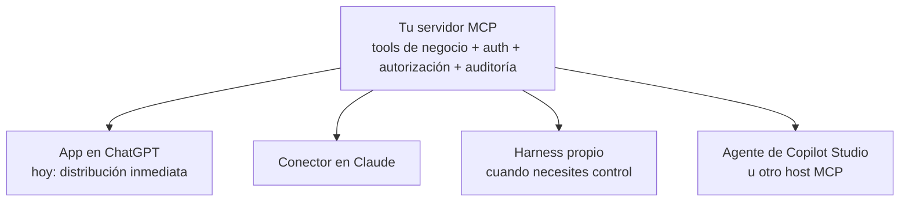
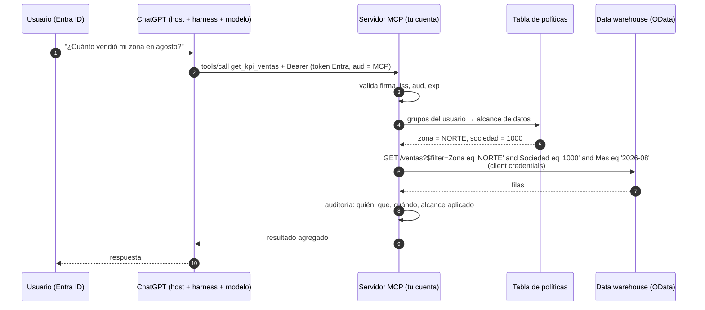

# 08 · App en ChatGPT vs harness propio

## Concepto

Cuando publicás una **app en ChatGPT** (o un conector personalizado en Claude, o un plugin en Copilot), **no estás construyendo un agente**. Estás construyendo **un servidor MCP** (más, opcionalmente, una interfaz) que el agente de otro, con su harness y su modelo, va a consumir.

Es la topología T2 del capítulo 07: **host, harness y modelo son del proveedor; el servidor MCP y los datos son tuyos.**

## Por qué esta decisión importa

Es una de las primeras decisiones de arquitectura en cualquier empresa que ya compró licencias de un asistente corporativo: ¿construimos sobre el asistente que la gente ya usa, o montamos nuestro propio agente?

La respuesta correcta casi nunca es "uno u otro para siempre". Es entender **qué parte del sistema estás construyendo en cada caso** y cuál es portable.

## Qué es una app de ChatGPT, técnicamente

| Componente | Qué es | Lo aportás vos |
|---|---|---|
| **Servidor MCP** | Tus tools, en Streamable HTTP, alcanzable por HTTPS desde la infraestructura de OpenAI | Sí |
| **Autenticación** | OAuth 2.1 contra tu IdP (o sin auth para datos públicos) | Configurás tu IdP |
| **UI (opcional)** | Componentes HTML que ChatGPT renderiza en un iframe aislado dentro del chat. Es la base del Apps SDK de OpenAI y hoy está estandarizado como la extensión **MCP Apps** | Sí |
| **Metadata** | Nombre, descripción e íconos de la app | Sí |
| **Host, harness, modelo, memoria, UI del chat** | Todo lo demás | **No: es de OpenAI** |

### El ciclo de vida en un workspace corporativo

Según la documentación de OpenAI a mediados de 2026, en planes Business y Enterprise:

1. Un **admin u owner habilita el modo desarrollador** en la configuración del workspace. En Enterprise, se puede delegar con RBAC a desarrolladores específicos.
2. Se **crea la app**: URL del servidor MCP, configuración de auth y un paso de escaneo de las tools que expone.
3. Se **prueba como borrador**.
4. Un admin la **publica** para el workspace.
5. Los admins controlan **qué roles pueden usarla**, qué acciones requieren **confirmación** y qué acciones se permiten.
6. En Enterprise, las llamadas quedan registradas en la **Compliance API** y en los logs.

OpenAI deja explícito que **la organización es responsable de verificar** cualquier app o conector que habilita, incluidos los del catálogo público. El vetting es tuyo.

!!! note "Otras superficies dentro de ChatGPT"
    - **GPTs personalizados:** instrucciones + archivos de conocimiento + acciones. Es lo más parecido a "tener tu system prompt" dentro de ChatGPT.
    - **Workspace agents:** agentes compartidos con instrucciones, apps, skills y servidores MCP personalizados, que pueden correr programados, en Slack o disparados por API.

    Las tres (apps, GPTs y workspace agents) consumen **el mismo tipo de servidor MCP**. Lo que cambia es cuánto control tenés sobre las instrucciones y el flujo.

## Qué controlás y qué no

| Aspecto | App en ChatGPT | Harness propio |
|---|---|---|
| **Modelo** | El de OpenAI que elija el usuario o el admin | El que elijas, incluso cambiarlo por tarea |
| **System prompt** | **No es tuyo.** Influís con las descripciones de tools y la metadata. Con GPTs o workspace agents sumás instrucciones propias | Completo |
| **Context engineering** | Lo hace ChatGPT: memoria del usuario, historial, otras apps activas en la conversación | Todo tuyo |
| **Otras tools en la conversación** | El usuario puede tener otras apps activas a la vez; el modelo puede combinar datos de tu app con otra | Solo las que vos habilitás |
| **Comportamiento del harness** | Cambia cuando OpenAI actualiza el producto, sin aviso a vos | Versionado por vos |
| **UI** | El chat de ChatGPT + widgets propios en iframe | La que construyas (Teams, Slack, web) |
| **Distribución** | **Inmediata: los usuarios ya están ahí** | Tenés que llevar a los usuarios a tu interfaz |
| **Identidad** | OAuth desde ChatGPT a tu servidor con tu IdP | La que diseñes |
| **Observabilidad** | Ves **solo las llamadas a tu servidor**. La conversación completa, vía Compliance API (Enterprise) | Traces completos de cada paso |
| **Evals** | Difíciles: no podés correr el harness de ChatGPT en tu CI. Podés testear tus tools y hacer evals manuales end-to-end | Suites automáticas en CI |
| **Costo** | Incluido en la licencia (con límites por plan) | Por token + infraestructura |
| **Red** | Tu servidor debe ser alcanzable desde internet | Privado en tu VPC |
| **Datos** | Resultados de tools y conversación en OpenAI, según el contrato Enterprise | En tu cuenta y región |
| **Lock-in** | La experiencia está atada a ChatGPT; **el servidor MCP no** | Atado a tu stack |

## ¿Dónde va el contexto de negocio en una app de ChatGPT?

Esta es la pregunta que más se confunde. Como no controlás el system prompt, el contexto de negocio se reparte así:

| Tipo de contexto | Dónde va en ChatGPT |
|---|---|
| Qué hace cada tool y cuándo usarla | **Descripciones de las tools** del servidor MCP. Es tu principal palanca |
| Reglas de dominio ("la campaña va de julio a junio") | Descripciones de las tools, o **resultados enriquecidos** (la tool devuelve "campaña 2026/27 (jul-2026 a jun-2027)" en lugar de fechas sueltas) |
| Rol, tono, formato | Instrucciones de un **GPT personalizado** o **workspace agent** que use la app |
| Datos vivos | Tools, como siempre |
| Documentos | Archivos de conocimiento del GPT, conectores de SharePoint/Drive, o una tool de búsqueda en tu servidor |
| Qué **no** puede hacer | **En el servidor**: la tool no existe o rechaza. Y en la configuración de acciones del admin |

La lección: en ChatGPT, **el servidor MCP tiene que ser más "inteligente" que en un harness propio**. Resultados autoexplicativos, errores descriptivos y descripciones precisas compensan que no controlás las instrucciones.

## El activo portable: el servidor MCP

Si el **conocimiento del negocio y la autorización viven en el servidor MCP**, cambiar de host es cambiar de cliente. Por eso la recomendación es:

1. **Arrancá por donde están los usuarios.** Si la empresa ya invirtió en ChatGPT Enterprise y en capacitar a la gente, publicar ahí tiene costo de adopción casi cero.
2. **Invertí en el servidor MCP como si fuera un producto**: tools de negocio, identidad, autorización en el servidor, auditoría y tests.
3. **Construí un harness propio solo cuando lo justifique un caso concreto**: flujos con pasos obligatorios, acciones de alto impacto con aprobación, necesidad de evals automáticas, restricciones de residencia de datos o un modelo específico.

## Caso de estudio: app conversacional sobre un data warehouse vía OData

Un escenario típico en empresas que ya tienen un data warehouse SaaS (por ejemplo SAP Datasphere) y licencias de ChatGPT Enterprise:

- **Objetivo:** que los usuarios de negocio consulten KPIs en lenguaje natural desde ChatGPT.
- **Fuente:** vistas analíticas expuestas por **OData**.
- **IdP corporativo:** Entra ID.
- **Restricción:** los usuarios de negocio **no existen** en el data warehouse. Solo hay **credenciales técnicas** (client credentials).
- **Requisito:** cada usuario ve **solo sus datos** (su zona, su sociedad, su unidad de negocio).

### El problema de identidad

Es el caso de manual del *confused deputy*: el servidor MCP accede con una identidad técnica que ve todo, en nombre de usuarios que deberían ver solo una parte. La fuente de datos no puede filtrar por usuario porque no sabe quién es.

### Arquitectura

### Opciones de enforcement

| Opción | Cómo funciona | Pros | Contras |
|---|---|---|---|
| **A. Enforcement en el servidor MCP** | El servidor mapea grupos de Entra → alcance de datos, y **agrega un filtro obligatorio** a cada consulta OData | Funciona sin tocar el data warehouse; implementable ya | Toda la responsabilidad está en tu código: un bug expone datos. Exige tests exhaustivos y auditoría |
| **B. Propagar identidad al data warehouse** | Federar el data warehouse con Entra ID (por ejemplo vía el servicio de identidad de la plataforma, con SAML u OIDC) para que conozca al usuario y aplique sus **controles de acceso a datos** nativos | Defensa en la capa de datos: el estándar de oro | Requiere que la plataforma lo soporte y alta de usuarios; más lento de implementar. **Validar con el proveedor** |
| **C. Un usuario técnico por perfil** | Varias credenciales técnicas, una por zona o rol, y el servidor elige cuál usar según el grupo del usuario | La fuente filtra con sus propios permisos | Proliferación de credenciales; la elección sigue en tu código |

**Recomendación:** arrancar con **A** bien hecho, como PoC y primera versión, y evaluar **B** en paralelo como objetivo. **A** es seguro si respetás estas reglas:

1. **El filtro de alcance sale del token, nunca de un argumento que elige el modelo.** El modelo elige *qué* consultar (mes, KPI); el servidor decide *qué parte* puede ver el usuario.
2. **Composición con AND:** el filtro obligatorio se combina con cualquier filtro del modelo con `and`, nunca reemplazable.
3. **Nada de OData libre:** el modelo no arma URLs OData. Las tools reciben parámetros tipados (`mes`, `kpi`, `producto` con `enum`) y el servidor construye la consulta con validación de campos contra un allowlist. Sin esto tenés **OData injection**.
4. **Solo vistas curadas:** exponé vistas de consumo pensadas para esto, no el modelo completo.
5. **Default deny:** usuario sin grupo mapeado = sin acceso, no acceso total.
6. **Tests de autorización** en CI: para cada perfil, qué ve y qué **no** ve.
7. **Auditoría** con usuario, tool, parámetros y alcance aplicado.

### Qué le da ChatGPT y qué le falta a este caso

| Le da | Le falta |
|---|---|
| Distribución inmediata a usuarios ya capacitados | Control del prompt: la semántica del negocio tiene que vivir en descripciones y resultados |
| Login con Entra ID vía OAuth | Evals automáticas del comportamiento end-to-end |
| Controles de admin: publicación, roles, confirmación de acciones | Red privada: el servidor debe exponerse a internet con WAF |
| Logs de compliance | Observabilidad del razonamiento del modelo (solo ves llamadas a tu servidor) |

Y el servidor MCP que construís queda **reutilizable** para un harness propio o para Claude si mañana hace falta.

## Criterio de decisión

| Si… | Entonces |
|---|---|
| Los usuarios ya viven en ChatGPT, el caso es de consulta y la empresa ya pagó licencias | **App en ChatGPT** |
| El flujo tiene pasos obligatorios, aprobaciones o compliance estricto | **Harness propio** (LangGraph o similar) |
| Los datos no pueden salir de tu nube o región | **Harness propio** con modelo en Bedrock |
| Necesitás evals automáticas antes de cada cambio | **Harness propio** |
| El agente actúa sin usuario (batch, eventos, programado) | **Harness propio**, o workspace agents si alcanza |
| Querés probar valor en semanas | **App en ChatGPT** primero, con el servidor MCP bien hecho |

## Antipatrones

| Antipatrón | Consecuencia |
|---|---|
| "Es ChatGPT Enterprise, así que la seguridad está resuelta" | OpenAI protege su plataforma; **la autorización de tus datos es tuya** |
| Poner la lógica de negocio en instrucciones de un GPT y dejar el servidor MCP "tonto" | La lógica no es portable, no se testea y el modelo la puede ignorar |
| Exponer una tool genérica de OData con URL libre | OData injection y fuga de datos |
| Servidor público sin WAF ni validación de `aud` | Endpoint corporativo abierto a internet |
| Dar por sentado que la conversación queda solo en tu tenant | Los datos que devuelven tus tools van a OpenAI; revisá el contrato y la retención |

## Recall

??? question "¿Qué construís exactamente cuando 'hacés una app de ChatGPT'? ¿Qué no construís?"
    **Construís:** un servidor MCP remoto (tools, auth, autorización, auditoría), opcionalmente componentes de UI (MCP Apps / Apps SDK) y la metadata de la app. **No construís:** el host, el harness, el loop, el modelo, la memoria ni el ensamblado de contexto. Todo eso es de OpenAI.

??? question "Sin control del system prompt, ¿cuáles son tus tres palancas para que el modelo use bien tu app?"
    1. **Descripciones de tools** precisas: qué hace, cuándo usarla, cuándo no, con ejemplos de valores.
    2. **Resultados autoexplicativos:** devolver contexto de negocio junto con el dato ("campaña 2026/27, jul-2026 a jun-2027; fuente: vista X, actualizada 08:00").
    3. **Errores accionables** que guían al modelo a corregirse.

    (Cuarta, si aplica: instrucciones en un GPT personalizado o workspace agent que envuelva la app.)

??? question "En el caso OData con client credentials, ¿por qué el filtro de zona no puede ser un parámetro de la tool?"
    Porque todo parámetro de una tool **lo elige el modelo**, y el modelo es influenciable por el usuario o por una injection. Si `zona` fuera un parámetro, el usuario de la zona NORTE podría pedir "mostrame la zona SUR" y el modelo pasaría `zona=SUR`. El alcance tiene que derivarse **del token validado** (grupos de Entra ID → política), en el servidor, y combinarse con AND con cualquier otro filtro.

??? question "Tu gerente pregunta: '¿no es tirar plata construir el MCP para ChatGPT si en un año hacemos agente propio?'. ¿Qué le respondés?"
    Que el servidor MCP **es la parte que se conserva**. Contiene las tools de negocio, la autorización y la auditoría, y lo consume cualquier host compatible con MCP: ChatGPT, Claude, Copilot o un harness propio. Si en un año hacemos un agente propio, reutiliza el mismo servidor. Lo que es específico de ChatGPT (la metadata y quizás la UI) es la parte chica. Empezar por ChatGPT da valor en semanas con los usuarios ya capacitados, sin tirar nada.
