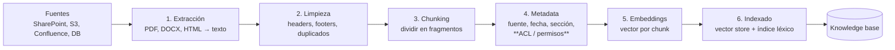
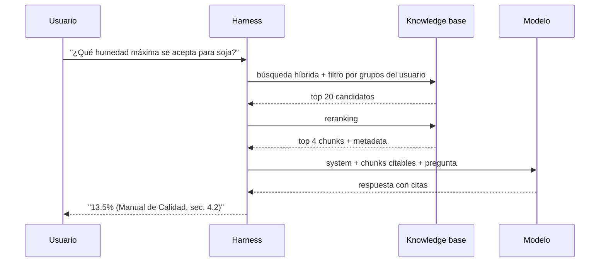

# 09 · Conocimiento: ingesta, RAG y cuándo no usarlo

## Concepto

**RAG** (Retrieval-Augmented Generation) es el patrón de **recuperar fragmentos relevantes de un corpus de documentos y agregarlos al contexto** antes de que el modelo responda. El modelo no "aprende" los documentos: los lee en el momento, como si le pasaras las páginas justas del manual.

Tiene dos mitades que corren en tiempos distintos:

- **Ingesta (offline):** preparar e indexar los documentos. Un pipeline de datos.
- **Retrieval (online):** en cada pregunta, buscar los fragmentos relevantes y meterlos en el contexto.

## Por qué existe

Porque hay conocimiento que:

- **No está en el modelo:** tus manuales internos, tus políticas, tus contratos.
- **No entra (o no conviene meter) en la ventana:** 20.000 páginas de documentación.
- **Cambia:** la política de viáticos de este año no es la del año pasado.

Reentrenar un modelo para cada cambio de documentación es caro, lento y no da trazabilidad. RAG permite **actualizar el conocimiento actualizando un índice**, y **citar la fuente** de cada respuesta.

## Cómo funciona: embeddings en cinco minutos

Un **embedding** es un vector de números (por ejemplo, 1.024 dimensiones) que representa el **significado** de un texto. Lo produce un modelo especializado de embeddings. Textos con significado parecido quedan cerca en ese espacio vectorial.

```text
"humedad máxima admitida para soja"    → [0.12, -0.83, 0.44, ...]
"¿con cuánta humedad se recibe soja?"  → [0.11, -0.80, 0.47, ...]   ← cerca
"política de viáticos al exterior"     → [-0.65, 0.20, -0.09, ...]  ← lejos
```

La cercanía se mide con **similitud coseno**: el coseno del ángulo entre dos vectores (1 = misma dirección, 0 = ortogonales, sin relación). Es álgebra lineal pura: buscar "los documentos más parecidos a mi pregunta" es buscar **los k vectores con mayor coseno respecto al vector de la pregunta**. Los vector stores usan índices aproximados (como HNSW) para hacerlo rápido entre millones de vectores sin compararlos todos.

**Lo que los embeddings hacen bien:** encontrar texto con el mismo significado aunque use otras palabras (sinónimos, paráfrasis).

**Lo que hacen mal:** coincidencias exactas (códigos de producto, números de norma, nombres propios raros), negaciones y cualquier cosa numérica o de fechas.

## La mitad offline: el pipeline de ingesta



### 1. Extracción

Convertir documentos a texto. Parece trivial y es donde se rompe todo: tablas en PDFs que se convierten en sopa de números, documentos escaneados que necesitan OCR, planillas con estructura. **La calidad del RAG tiene como techo la calidad de la extracción.**

### 2. Limpieza

Quitar ruido (encabezados, pies de página, índices repetidos, avisos legales en cada página) y deduplicar versiones del mismo documento.

### 3. Chunking

Dividir el texto en fragmentos. Es la decisión más importante del pipeline:

| Estrategia | Cómo | Cuándo |
|---|---|---|
| **Tamaño fijo** | N tokens por chunk (ej. 500), con solapamiento (ej. 50) | Punto de partida simple |
| **Por estructura** | Respetar secciones, títulos y párrafos del documento | Documentos bien estructurados (manuales, normas) |
| **Semántico** | Cortar donde cambia el tema (medido con embeddings) | Textos largos sin estructura clara |
| **Jerárquico** | Chunks chicos para buscar; al encontrar, se devuelve el padre más grande | Cuando necesitás precisión en la búsqueda y contexto en la respuesta |

**El trade-off:** chunks chicos son más precisos en la búsqueda, pero pierden contexto ("el valor máximo es 13,5%", ¿de qué?). Chunks grandes conservan contexto, pero diluyen la señal. Una técnica efectiva es **contextualizar cada chunk**: anteponerle una línea generada que diga de qué documento y sección viene ("Manual de calidad, capítulo Recepción de soja: el valor máximo es 13,5%").

### 4. Metadata, incluidos los permisos

Cada chunk guarda: documento de origen, URL, fecha, sección, versión y **quién puede verlo**.

!!! danger "La fuga de datos número uno en RAG corporativo"
    Si indexás un SharePoint entero y **no guardás los permisos de cada documento** como metadata, el RAG le devuelve a cualquier usuario fragmentos de documentos que en SharePoint no podía abrir. El usuario de ventas pregunta por "aumentos" y recibe fragmentos de la planilla de sueldos de RRHH.

    **Regla:** en la ingesta, copiás las ACL (grupos o usuarios con acceso) a la metadata de cada chunk. En el retrieval, **filtrás por la identidad del usuario antes de rankear**. Y tenés que **sincronizar los cambios de permisos**, no solo los de contenido.

### 5 y 6. Embeddings e indexado

Se calcula el embedding de cada chunk y se guarda en un **vector store**, idealmente junto a un **índice léxico** (búsqueda por palabras, tipo BM25) para la búsqueda híbrida.

### Operación del pipeline

- **Disparo:** por eventos (un archivo nuevo en S3 dispara el procesamiento) o batch programado.
- **Incremental:** reprocesar solo lo que cambió.
- **Borrados:** si un documento se borra o se restringe en origen, tiene que desaparecer del índice. Es lo que más se olvida.
- **Versionado:** si cambiás el modelo de embeddings o la estrategia de chunking, **hay que reindexar todo** (vectores de modelos distintos no son comparables).

En AWS: Step Functions o Lambda orquestando, S3 como staging, o la sincronización gestionada de **Bedrock Knowledge Bases** con conectores a S3, SharePoint, Confluence y otros.

## La mitad online: retrieval



| Técnica | Qué hace | Por qué |
|---|---|---|
| **Búsqueda semántica** | Similitud de embeddings | Encuentra paráfrasis |
| **Búsqueda léxica (BM25)** | Coincidencia de palabras | Encuentra códigos, números y nombres exactos |
| **Híbrida** | Combina las dos | **Lo que funciona en producción** |
| **Filtros por metadata** | Por permisos, fecha, tipo de documento | Seguridad y relevancia |
| **Reranking** | Un modelo especializado reordena los candidatos con más precisión | Mejora mucho la calidad del top-k |
| **Query rewriting** | Reformular la pregunta antes de buscar ("¿y para maíz?" → "humedad máxima admitida para maíz") | Preguntas de seguimiento que solas no tienen sentido |

### Agentic search: el agente busca solo

En lugar de un paso de retrieval fijo antes de responder, el agente tiene **tools de búsqueda** y decide cuándo, qué y cuántas veces buscar:

- `buscar_documentos(query, tipo, desde)`
- `leer_documento(id, seccion)`

Es lo que hace Claude Code con un repositorio: no indexa el código en embeddings; usa `Grep`, `Glob` y `Read` iterativamente. Para muchos corpus, un agente con búsqueda léxica + lectura **rinde igual o mejor que un RAG vectorial**, con mucha menos infraestructura. La contracara: más vueltas del loop, más latencia y más tokens.

## Cuándo sí y cuándo no usar RAG

| Situación | Solución | Por qué |
|---|---|---|
| Datos estructurados (ventas, stock, precios) | **Tools** (SQL, API) | Los embeddings no suman, no filtran fechas ni agregan |
| Corpus chico y estable (hasta ~50–100k tokens) | **Todo en el contexto, con prompt caching** | Lectura cacheada a ~10% del precio; no hay retrieval que falle |
| Procedimiento que se lee entero | **Skill** | No se recupera por fragmentos |
| Corpus grande, textual y cambiante, preguntas semánticas | **RAG híbrido** | No entra en la ventana y la pregunta es "qué dice X sobre Y" |
| Búsqueda exacta (códigos, IDs) | **Búsqueda léxica o agentic search** | Los embeddings fallan con strings exactos |
| El corpus ya vive en un sistema con buscador (SharePoint, Confluence) | **Tool que usa el buscador nativo** (vía MCP del vendor) | Reutilizás su índice y **sus permisos** |

**Regla:** RAG es lo último que se agrega. Primero tools y caching; RAG cuando midas que falta conocimiento que no entra en la ventana.

### Un cálculo rápido

Un manual de 60.000 tokens, 1.000 preguntas por día:

- **En contexto, sin caché:** 60M tokens de input por día.
- **En contexto, con caché:** los mismos 60M, pero a ~10% del precio → equivalentes a ~6M de input normal, más las escrituras de caché.
- **RAG con 4 chunks de 500 tokens:** 2M tokens de input por día, más el costo de la infraestructura del vector store y el pipeline, más el riesgo de que el retrieval no traiga el fragmento correcto.

Con caché, la diferencia de costo se achica mucho, y el caché **no tiene modo de fallo de retrieval**. Para corpus chicos, gana el contexto completo. Para corpus de millones de tokens, RAG es la única opción.

## Cómo se mide un RAG

Se evalúan las dos mitades por separado:

| Métrica | Qué mide | Cómo |
|---|---|---|
| **Recall@k** | ¿El chunk correcto está entre los k recuperados? | Set de preguntas con su chunk esperado |
| **MRR** (Mean Reciprocal Rank) | ¿En qué posición aparece el correcto? | Idem |
| **Faithfulness** | ¿La respuesta se apoya en los chunks, o inventa? | Evaluación con un modelo juez o humana |
| **Answer relevance** | ¿Responde lo que se preguntó? | Idem |

Si la respuesta está mal, la primera pregunta es **"¿el retrieval trajo el fragmento correcto?"**. Si no lo trajo, el problema está en la ingesta o en la búsqueda, no en el modelo.

## Opciones en AWS

| Servicio | Qué es | Cuándo |
|---|---|---|
| **Bedrock Knowledge Bases** | RAG gestionado: conectores, chunking, embeddings, sincronización y retrieval | Arrancar rápido, sin operar el pipeline |
| **OpenSearch Service / Serverless** | Motor de búsqueda con vectores + BM25 | Búsqueda híbrida real y control fino |
| **Aurora PostgreSQL + pgvector** | Vectores dentro de tu Postgres | Ya tenés Postgres y querés joins entre vectores y datos relacionales |
| **S3 Vectors** | Almacenamiento de vectores de bajo costo en S3 | Volúmenes grandes con consultas menos frecuentes |

## Antipatrones

| Antipatrón | Consecuencia |
|---|---|
| Indexar SharePoint sin ACLs | Fuga de documentos restringidos |
| RAG sobre datos tabulares (exportar ventas a PDF e indexar) | Respuestas numéricas inventadas; usá tools |
| Solo búsqueda vectorial | Falla con códigos, números y nombres propios |
| No sincronizar borrados | El agente cita documentos que ya no existen o fueron restringidos |
| Cambiar de modelo de embeddings sin reindexar | Vectores incomparables, resultados basura |
| Evaluar solo "¿la respuesta suena bien?" | No sabés si falla el retrieval o la generación |

## Recall

??? question "¿Por qué los embeddings fallan con 'norma IRAM 12345' y cómo lo resolvés?"
    Porque un embedding captura **significado**, y un código como "12345" no tiene significado semántico distintivo: queda cerca de cualquier otro número de norma. La solución es **búsqueda híbrida**: el componente léxico (BM25) encuentra la coincidencia exacta del token "12345", y el semántico cubre las paráfrasis.

??? question "Un usuario se queja de que el asistente citó un procedimiento derogado hace dos meses. ¿Dónde está la falla?"
    En el **pipeline de ingesta**: no se sincronizaron los **borrados o cambios de estado** del documento en origen. El índice sigue teniendo los chunks viejos. Correcciones: sincronización incremental que procese bajas, metadata de vigencia (versión, fecha de derogación) y un filtro por "vigente" en el retrieval.

??? question "¿Qué es más barato y confiable para un glosario de 40k tokens consultado 500 veces por día: RAG o contexto con caché? Justificá."
    **Contexto con caché.** 40k tokens × 500 = 20M tokens por día, pero en lecturas cacheadas a ~10% del precio. Sin infraestructura de vector store, sin pipeline y **sin modo de fallo de retrieval** (el modelo siempre ve todo el glosario). RAG agregaría costo operativo y el riesgo de no traer la definición correcta, para ahorrar poco.

??? question "¿Qué tiene que pasar en la ingesta y en el retrieval para que el RAG respete permisos?"
    - **Ingesta:** copiar las **ACL** de cada documento (grupos o usuarios) a la metadata de cada chunk, y **sincronizar cambios de permisos**, no solo de contenido.
    - **Retrieval:** obtener la identidad del usuario (del token) y sus grupos, y aplicar un **filtro por ACL antes del ranking**, en el vector store. Nunca filtrar después con el modelo.
