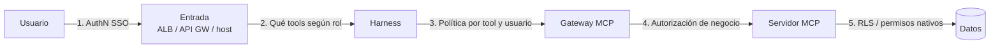
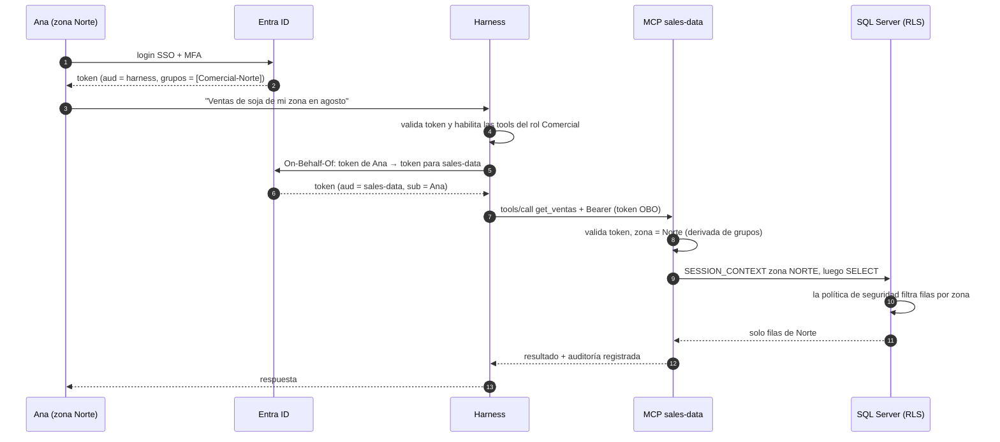

# 10 · Identidad y autorización: usuario A vs usuario B

## Concepto

En un sistema agéntico hay **tres identidades** en juego, y la gobernanza consiste en que cada acción se autorice con la correcta:

| Identidad | Quién es | Ejemplo |
|---|---|---|
| **Usuario** | La persona que pide | `ana.perez@agrocorp.com`, zona Norte |
| **Agente** | El workload que ejecuta: una identidad no humana | Rol IAM `agent-comercial`, client ID en Entra |
| **Backend** | Con qué credencial se accede efectivamente a los datos | Login de SQL, credencial técnica del data warehouse |

La pregunta de diseño central: **cuando el agente accede a un dato, ¿con qué permisos lo hace: los del usuario, los del agente o la intersección?**

La respuesta correcta para agentes que actúan en nombre de alguien: **la intersección**. El agente nunca debe poder hacer más que el usuario (sino es un *confused deputy*), y el usuario, a través del agente, nunca debe poder hacer más de lo que el agente tiene habilitado (sino el agente es un bypass de los controles).

```text
Permisos efectivos = permisos del usuario ∩ permisos del agente
```

## Por qué es el problema más difícil

En una aplicación tradicional, el código es determinístico: si el endpoint `/ventas` filtra por zona, siempre filtra. En un agente, **el camino de ejecución lo decide un modelo probabilístico influenciable por texto**. No podés auditar "qué va a hacer el agente" leyendo el código, porque depende de lo que el modelo decida en cada caso.

Consecuencia: **los controles tienen que estar en las capas determinísticas** (harness, gateway, servidor MCP, base), nunca solo en el comportamiento del modelo.

## Defensa en profundidad: cinco puntos de control



| # | Punto | Qué verifica | Ejemplo |
|---|---|---|---|
| 1 | **Entrada** | ¿Está autenticado? ¿Puede usar este agente? | ALB con OIDC contra Entra ID; grupo "Usuarios-Asistente-Comercial" |
| 2 | **Harness** | ¿Qué tools se le ofrecen al modelo para este usuario? | Un analista no ve la tool `aprobar_descuento`; un gerente sí |
| 3 | **Gateway** | ¿Este usuario puede invocar esta tool con estos argumentos? | Política Cedar: rol `Comercial` → `get_ventas` permitido |
| 4 | **Servidor MCP** | ¿Este usuario puede ver *este* cliente o *esta* zona? | Mapeo de grupos a alcance de datos |
| 5 | **Datos** | ¿La identidad de la conexión puede leer esta fila? | Row-Level Security en SQL Server |

No hace falta tener los cinco en todos los casos, pero cada uno que falta **transfiere la responsabilidad al siguiente**. Si solo tenés el 5, estás bien protegido. Si solo tenés el 2, un bug o una injection expone todo.

**El punto 2 merece una aclaración:** ocultar tools según el rol no es solo seguridad, es calidad. Menos tools irrelevantes = menos tokens y mejores decisiones del modelo.

## El flujo completo, de punta a punta



Si **Bruno (zona Sur)** hace la misma pregunta, cada paso es idéntico excepto la identidad. **El código del agente y el system prompt son los mismos**; lo que cambia es el token, y la base devuelve otras filas. No hay instrucción en el prompt que pueda cambiar eso.

## Patrones de delegación

| Patrón | Cómo | Cuándo | Riesgo |
|---|---|---|---|
| **Token propagation + OBO** | El token del usuario se intercambia en cada salto por uno con la audiencia correcta | La fuente de datos conoce a los usuarios del IdP | El más seguro; requiere soporte en cada capa |
| **Service identity + autorización en app** | El servidor MCP accede con su credencial, pero filtra según el usuario del token | La fuente no conoce usuarios (client credentials) | Todo depende de tu código; exige tests de autorización |
| **Service identity + contexto de sesión en la base** | El servidor MCP se conecta con su credencial y **le dice a la base** quién es el usuario; la base aplica RLS | SQL Server, PostgreSQL | Buen equilibrio: la base aplica la regla; la app debe setear el contexto correctamente |
| **ABAC con session tags en AWS** | El harness asume un rol IAM con **tags de sesión** tomados del token (zona, sociedad), y las policies usan `${aws:PrincipalTag/zona}` | Datos en S3, DynamoDB, servicios AWS | IAM aplica el filtro; limitado a lo que IAM puede expresar |

### Row-Level Security en SQL Server

Lo que ya conocés de SQL Server resuelve el punto 5 con el tercer patrón:

```sql
-- 1. Función predicado: devuelve 1 si la fila es visible para la sesión actual
CREATE FUNCTION seguridad.fn_filtro_zona(@zona AS NVARCHAR(20))
RETURNS TABLE
WITH SCHEMABINDING
AS
RETURN
    SELECT 1 AS permitido
    WHERE @zona = CAST(SESSION_CONTEXT(N'zona') AS NVARCHAR(20))
       OR CAST(SESSION_CONTEXT(N'rol') AS NVARCHAR(20)) = N'GerenteNacional';
GO

-- 2. Política de seguridad sobre la tabla de ventas
CREATE SECURITY POLICY seguridad.politica_ventas
    ADD FILTER PREDICATE seguridad.fn_filtro_zona(zona) ON dbo.ventas
    WITH (STATE = ON);
GO
```

Y en el servidor MCP, **en cada request**, antes de la consulta:

```sql
EXEC sp_set_session_context @key = N'zona', @value = N'NORTE', @read_only = 1;
EXEC sp_set_session_context @key = N'rol',  @value = N'Comercial', @read_only = 1;
SELECT SUM(toneladas) FROM dbo.ventas WHERE producto = 'soja' AND ...;
```

!!! warning "Cuidado con el connection pooling"
    El pool reutiliza conexiones entre requests. Si el contexto de sesión del usuario A queda en la conexión y el siguiente request (usuario B) no lo sobrescribe, **B hereda los permisos de A**. Setealo siempre al tomar la conexión, usá `@read_only = 1` y verificá que el driver resetee la conexión al devolverla al pool (`sp_reset_connection`).

    Default seguro: si no hay contexto, la función predicado no devuelve filas. Nunca "si no hay contexto, mostrar todo".

## Autorización de tools: allowlist por rol

En el harness (punto 2) o en el gateway (punto 3):

```yaml
# Ilustrativo: configuración del harness
roles:
  Comercial:
    tools: [get_ventas, get_stock, buscar_manual_calidad]
  GerenteComercial:
    tools: [get_ventas, get_stock, buscar_manual_calidad, aprobar_descuento]
    require_approval: [aprobar_descuento]
  default:
    tools: []          # default deny
```

Con AgentCore Gateway, lo mismo se expresa como **políticas Cedar** evaluadas en cada tool call:

```cedar
// Ilustrativo
permit (
    principal in Group::"GerenteComercial",
    action == Action::"InvokeTool",
    resource == Tool::"aprobar_descuento"
) when {
    context.arguments.porcentaje <= 10
};
```

Fijate que Cedar puede condicionar sobre los **argumentos**: un gerente puede aprobar descuentos de hasta 10% sin escalar. Eso es autorización determinística sobre una decisión del modelo.

## Human-in-the-loop

Para acciones con efectos, la aprobación humana es un control, no una cortesía.

| Tipo de acción | Control |
|---|---|
| Lectura | Sin aprobación |
| Escritura reversible y de bajo impacto (crear borrador, etiquetar) | Aprobación opcional o por umbral |
| Escritura con impacto (enviar mail externo, crear orden, modificar precios) | **Aprobación explícita del usuario** mostrando exactamente qué se va a ejecutar |
| Acción de alto impacto o irreversible (pagos, borrados, cambios masivos) | **Aprobación de un tercero** (flujo asíncrono) o directamente no disponible para el agente |

Mecanismos:

- **En el harness:** antes de ejecutar ciertas tools, pausa y pide confirmación en la UI.
- **En el protocolo:** MRTR de MCP (capítulo 06), el servidor devuelve `input_required` y pide confirmación.
- **En el host:** ChatGPT y Claude piden confirmación para tools no marcadas como `readOnlyHint`, y los admins pueden configurar qué acciones la requieren.
- **Asíncrono:** el agente crea una solicitud en un sistema de aprobaciones (ServiceNow, Jira, Step Functions con callback) y retoma cuando se aprueba.

!!! tip "La aprobación tiene que mostrar el QUÉ, no el resumen del modelo"
    "¿Confirmás la acción?" no sirve. Mostrá los **parámetros reales** que se van a ejecutar: `crear_orden(cliente=004512, producto=soja, tn=500, precio=285 USD/tn)`. Si mostrás un resumen generado por el modelo, una injection puede hacer que el resumen diga una cosa y la acción haga otra.

## Agentes sin usuario

Un agente que corre programado (reporte diario) o por eventos (procesar facturas que llegan a S3) no tiene un usuario detrás. Actúa con **su propia identidad**:

- Un rol IAM o un client ID **dedicado por agente**, con mínimo privilegio para esa tarea.
- Nunca "la cuenta de servicio del equipo" compartida por varios agentes.
- Su propia auditoría: cada acción atribuible a ese agente.

Es la misma disciplina que ya aplicás con los roles de ejecución de Lambdas y tasks de ECS: una identidad por workload, permisos mínimos.

## Auditoría: qué registrar

Cada tool call debería dejar un registro con:

| Campo | Para qué |
|---|---|
| Timestamp, trace ID | Correlacionar con los traces del harness |
| Usuario (`sub`, email) | Quién pidió |
| Agente (client ID / rol) | Qué workload ejecutó |
| Tool y argumentos | Qué se hizo |
| Alcance de autorización aplicado | Qué filtro de datos se usó |
| Resultado (éxito, error, filas devueltas) | Qué pasó |
| Aprobación (si hubo), por quién | Trazabilidad de acciones |

Con esto podés responder la pregunta que te va a hacer auditoría: *"¿quién vio los datos del cliente X en marzo, a través de qué agente, y con qué permiso?"*

## Antipatrones

| Antipatrón | Consecuencia |
|---|---|
| Autorización en el system prompt | Una injection la anula |
| Filtro de alcance como parámetro de la tool | El modelo (o el usuario vía el modelo) lo elige |
| Service account con acceso total sin filtro por usuario | Confused deputy |
| Contexto de sesión de la base sin resetear en el pool | Un usuario hereda los permisos del anterior |
| Default allow cuando falta el mapeo de grupo | Un usuario nuevo o mal configurado ve todo |
| Una credencial compartida por todos los agentes | No hay atribución ni mínimo privilegio |
| Aprobación que muestra un resumen del modelo | Se aprueba algo distinto de lo que se ejecuta |

## Recall

??? question "Escribí la fórmula de permisos efectivos de un agente que actúa en nombre de un usuario y explicá qué pasa si falta cada término."
    **Efectivos = usuario ∩ agente.**

    - Si solo cuentan los del **agente**: el usuario accede, vía el agente, a todo lo que el agente puede (confused deputy).
    - Si solo cuentan los del **usuario**: el agente se convierte en un canal para que el usuario haga, sin los controles de la aplicación, cualquier cosa que su identidad permita en los sistemas subyacentes (por ejemplo, borrados que la UI normal no ofrece).

??? question "¿Por qué el punto de control 5 (datos) es el más robusto?"
    Porque es **el más cercano al dato y el más independiente del modelo**. Aunque falle todo lo anterior (injection que engaña al modelo, bug en el harness, tool mal diseñada), la base solo devuelve las filas que la identidad de la conexión puede ver. Es determinístico y no depende del camino de ejecución.

??? question "Implementaste RLS con SESSION_CONTEXT. En producción, un usuario reporta ver datos de otra zona de forma intermitente. ¿Hipótesis principal?"
    **Connection pooling con contexto residual.** Una conexión quedó con el `SESSION_CONTEXT` de un usuario de otra zona, y el request siguiente la tomó sin setear el suyo (por ejemplo, un camino de código que no pasa por el seteo, o un error que lo saltea). Correcciones: setear siempre al tomar la conexión, `@read_only = 1`, asegurar el reset al devolverla y que la función predicado no devuelva nada sin contexto.

??? question "Diseñá los controles para la tool `enviar_cotizacion_cliente` (manda un mail externo con precios)."
    - **Punto 2/3:** solo disponible para roles comerciales habilitados.
    - **Punto 4:** el servidor verifica que el usuario tenga asignado a ese cliente.
    - **Human-in-the-loop:** confirmación explícita mostrando destinatario, productos, precios y el texto final exacto.
    - **Tríada letal:** es un canal de salida. El agente que la tiene no debería procesar contenido no confiable en la misma sesión (mails entrantes, documentos de terceros).
    - **Auditoría** completa y límite de envíos por usuario por día.
