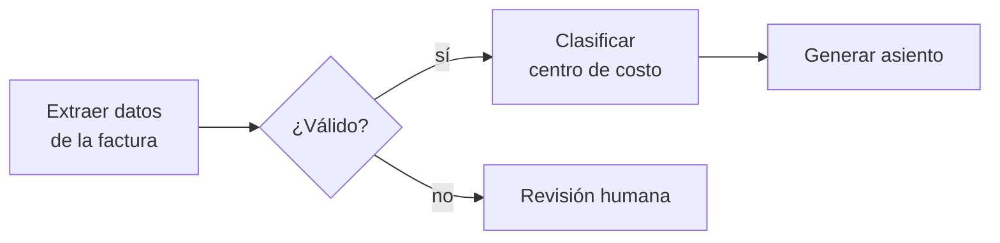
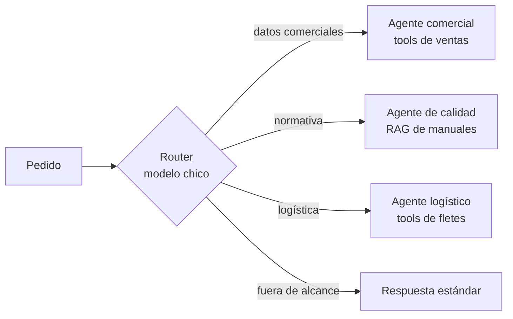
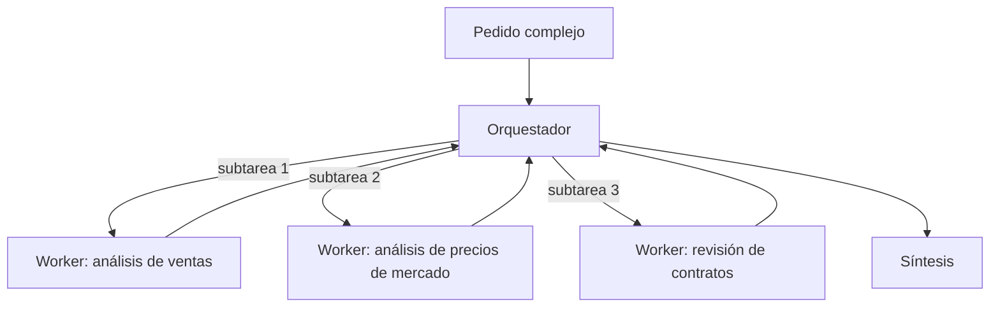
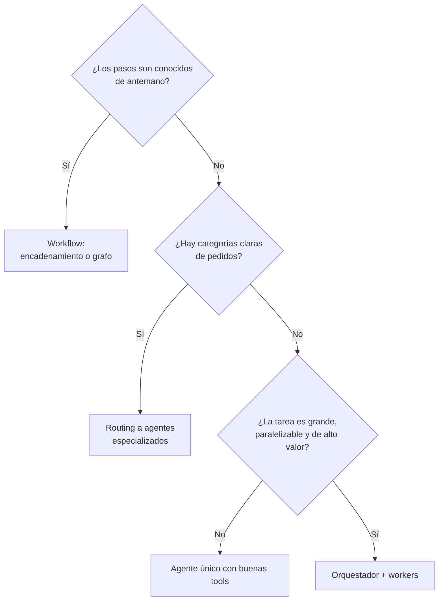

# 11 · Patrones: de un agente a multi-agente

## Concepto

Hay un espectro entre dos extremos:

- **Workflow:** el camino lo define el código. El modelo ejecuta pasos dentro de un flujo predeterminado.
- **Agente:** el camino lo define el modelo. Decide qué tools usar, en qué orden y cuándo terminar.

Y encima de eso, la pregunta de **cuántos agentes**: uno solo con muchas tools, o varios especializados coordinados.

## Por qué importa elegir bien

Cada paso hacia la autonomía y hacia más agentes **cuesta más tokens, más latencia y más dificultad para depurar y evaluar**. A cambio, gana flexibilidad para tareas abiertas. Elegir el patrón más complejo "por las dudas" es el error más caro del área.

Una referencia concreta: Anthropic reportó que en su sistema de investigación, un agente único usa del orden de **4 veces** los tokens de un chat simple, y el sistema multi-agente, del orden de **15 veces**. Funciona para investigación abierta y de alto valor. Para "¿cuánto vendimos en agosto?", es tirar plata.

## Los patrones, de simple a complejo

### 1. Llamada única aumentada

Un request al modelo con tools o contexto recuperado. Sin loop o con un loop corto.

**Ejemplo:** "¿Qué humedad máxima se acepta para soja?" → RAG → respuesta.

### 2. Encadenamiento (prompt chaining)

Una secuencia fija de pasos, cada uno con su llamada al modelo, con validaciones en el medio.

**Cuándo:** la tarea se descompone limpiamente en pasos conocidos.

### 3. Routing

Un clasificador (barato y rápido) decide **a qué flujo o agente especializado** mandar cada pedido.

**Cuándo:** hay categorías claras de pedidos con necesidades distintas (tools, contexto, incluso modelo). **Ventaja clave:** cada agente especializado tiene pocas tools y un prompt enfocado, lo que mejora calidad y costo. El router puede ser un modelo chico y barato.

### 4. Paralelización

Varias llamadas en paralelo, luego se combinan.

- **Sectioning:** partes independientes de una tarea (analizar 5 documentos a la vez).
- **Voting:** la misma tarea varias veces para comparar (revisión de seguridad de un contrato por tres revisores).

### 5. Orquestador y workers

Un agente **orquestador** descompone dinámicamente la tarea, **delega** subtareas a agentes **workers** y sintetiza los resultados.

**Diferencia con routing:** en routing el camino es uno y se decide al principio. En orquestación, el orquestador decide **cuántas y cuáles** subtareas crear según el caso, y puede iterar.

**Cuándo:** tareas abiertas, de alto valor, donde las subtareas son **paralelizables** y cada una necesita mucho contexto propio. Ejemplo: "Prepará el análisis de cierre de campaña: ventas vs plan por zona, comparación con precios de mercado y riesgos contractuales".

### 6. Evaluador-optimizador

Un agente genera y otro evalúa con criterios explícitos; se itera hasta cumplir.

**Cuándo:** hay criterios de calidad claros y verificables (un informe debe citar fuentes, un SQL debe pasar tests).

### 7. Agente autónomo

Un solo agente con tools, en loop, que decide todo hasta terminar. Es el patrón de Claude Code.

**Cuándo:** tareas abiertas donde no se puede predecir la cantidad de pasos.

## ¿Un agente que orquesta a otros según la tarea? Sí, se hace

La respuesta directa a la pregunta que originó este capítulo: **sí, es un patrón establecido y en producción**. Pero hay dos cosas distintas que se suelen llamar igual:

| Lo que la gente dice | Lo que suele necesitar | Patrón |
|---|---|---|
| "Un agente que decida qué agente usar según el tipo de trabajo" | Clasificar el pedido y derivarlo | **Routing** (barato, predecible) |
| "Un agente que coordine a otros para una tarea grande" | Descomponer, delegar en paralelo y sintetizar | **Orquestador-workers** (caro, flexible) |

La mayoría de los casos corporativos del primer tipo **se resuelven con routing**, no con un orquestador.

## Subagentes: el verdadero beneficio es el aislamiento de contexto

El motivo técnico más fuerte para usar varios agentes no es "especialización" en abstracto, sino **la ventana de contexto**:

- Un worker explora 50 documentos, gasta 200k tokens en su propia ventana y le devuelve al orquestador **un resumen de 2k tokens**.
- La ventana del orquestador queda limpia para razonar sobre la síntesis.

Es lo que hace Claude Code con los subagentes: delegar una búsqueda amplia en el repositorio para que el contexto principal no se llene de resultados intermedios.

## Cómo se implementa la orquestación

| Mecanismo | Cómo | Ejemplos |
|---|---|---|
| **Agentes como tools** | El orquestador ve a cada worker como una tool (`analizar_ventas(pregunta)`) | Strands, Claude Agent SDK (subagentes), OpenAI Agents SDK |
| **Handoffs** | Un agente transfiere la conversación completa a otro | OpenAI Agents SDK |
| **Grafo** | Nodos y transiciones explícitas entre agentes | LangGraph, Strands Graph |
| **A2A** | Agentes independientes (incluso de distintos equipos o vendors) se comunican por un protocolo estándar | Protocolo A2A, soportado en AgentCore y otros |

## Criterio de decisión

**Orden de adopción recomendado:**

1. **Agente único** con tools bien diseñadas. Medí.
2. Si el agente tiene demasiadas tools o los pedidos son muy distintos: **routing**.
3. Si hay tareas que requieren descomponer y paralelizar, y el valor justifica el costo: **orquestador**.

Cada salto se justifica con **datos de evals**, no con intuición.

## Costo estimado: un ejemplo numérico

Supuestos ilustrativos: una pregunta comercial típica.

| Patrón | Llamadas al modelo | Tokens de input aproximados | Relativo |
|---|---|---|---|
| Agente único, 2 tool calls | 3 | ~15k | 1× |
| Routing (router chico + agente especializado con 2 tool calls) | 4 (una muy barata) | ~12k (el agente tiene menos tools y prompt más corto) | ~0,8–1× |
| Orquestador + 3 workers, 3 tool calls cada uno | ~14 | ~120k | ~8× |

El routing puede ser **más barato** que un agente único generalista, porque cada agente especializado carga menos tools y menos contexto. El orquestador multiplica.

## Antipatrones

| Antipatrón | Consecuencia |
|---|---|
| Arrancar con multi-agente | 8 a 15 veces el costo sin evidencia de necesidad |
| Un agente por "departamento" que se pasan mensajes entre sí para preguntas simples | Latencia, costo y errores que se propagan entre agentes |
| Workers que devuelven todo su contexto al orquestador | Anula el beneficio del aislamiento |
| Orquestador sin límite de subtareas | Fan-out descontrolado |
| No poder evaluar cada agente por separado | Imposible saber cuál falla |

## Recall

??? question "¿Cuál es la diferencia operativa entre routing y orquestador-workers?"
    En **routing**, una clasificación al principio elige **un** camino y el pedido lo resuelve un solo agente especializado. En **orquestador-workers**, un agente descompone dinámicamente la tarea en **varias** subtareas, las delega (a menudo en paralelo), recibe los resultados y sintetiza, pudiendo iterar. Routing es barato y predecible; orquestación es cara y flexible.

??? question "¿Por qué routing puede costar menos que un agente único generalista?"
    Porque cada agente especializado tiene **menos tools y un prompt más corto**, así que cada llamada carga menos tokens. El router es un modelo chico y barato. Además, con menos tools irrelevantes el modelo elige mejor, lo que reduce vueltas del loop.

??? question "¿Cuál es el beneficio técnico principal de los subagentes, más allá de la 'especialización'?"
    **El aislamiento de la ventana de contexto.** El subagente consume muchos tokens explorando en su propia ventana y devuelve solo un resumen compacto. La ventana del agente principal no se llena de resultados intermedios, lo que mantiene la calidad del razonamiento y evita compactaciones.
