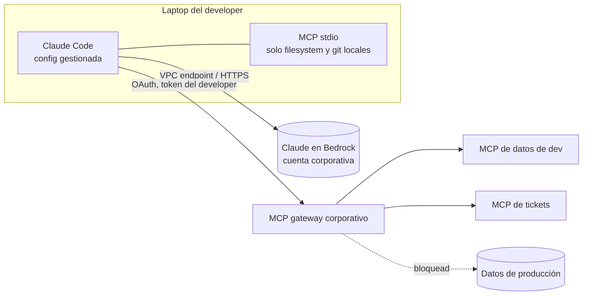

# 13 · Local vs cloud

## Concepto

"Local" se usa para dos cosas distintas, y conviene separarlas:

| Significado | Qué corre local | Qué sigue en la nube |
|---|---|---|
| **Harness local** | El harness y los MCP stdio en la laptop del usuario (Claude Code, Claude Desktop, Cursor) | El modelo (API del proveedor o Bedrock) |
| **Modelo local** | También la inferencia, en la laptop o en servidores propios (Ollama, vLLM con modelos open-weight) | Nada, o solo actualizaciones |

La mayoría de las discusiones corporativas son sobre el primer significado. El segundo aparece cuando hay restricciones fuertes de soberanía de datos.

## Por qué la decisión importa

La ubicación de cada pieza determina **quién custodia qué**:

- En local, **el usuario custodia** credenciales, configuración y qué servidores MCP instala.
- En cloud, **la plataforma custodia** todo eso, y el usuario solo prueba quién es.

Para 5 developers, lo local es eficiente. Para 600 usuarios de negocio, lo local es ingobernable.

## Comparación

| Dimensión | Harness local | Harness en la nube (propio o gestionado) |
|---|---|---|
| **Identidad** | La del usuario en su máquina | SSO central, propagada |
| **Secretos** | En la laptop (env, archivos, keychain) | En Secrets Manager / vault, nunca en el cliente |
| **Qué MCP se usan** | Lo que el usuario instale | Allowlist central en un registry o gateway |
| **Auditoría** | Dispersa o inexistente | Central |
| **Acceso a archivos locales** | Directo | No (o vía un puente explícito) |
| **Costo** | Por usuario, difícil de atribuir | Atribuible por app y equipo |
| **Actualizaciones** | Cada usuario | Un deploy |
| **Latencia a datos corporativos** | Depende de VPN | Dentro de la VPC |
| **Offline** | Parcial (sin modelo en la nube no hay agente) | No aplica |

## Una política razonable para una empresa mediana

| Perfil | Modo permitido | Condiciones |
|---|---|---|
| **Developers** | Harness local (Claude Code, IDE) | Configuración gestionada por la empresa: modelo vía Bedrock en la cuenta corporativa, **allowlist de servidores MCP**, sin credenciales de producción en laptops, MCP a datos corporativos solo remotos con OAuth |
| **Usuarios de negocio** | Solo cloud | Asistente corporativo (ChatGPT/Claude Enterprise) con apps publicadas por admins, o agentes propios en la nube |
| **Procesos automáticos** | Solo cloud | Harness en ECS / AgentCore con identidad de workload propia |
| **Datos restringidos por regulación** | Cloud en tu cuenta y región (modelo en Bedrock) o modelo local | Según la clasificación del dato |

### Controles concretos para lo local

Los harness de desarrollo corporativos suelen soportar **configuración gestionada por la organización** (políticas que el usuario no puede sobrescribir). Lo que conviene fijar:

- **Endpoint del modelo:** Bedrock en la cuenta corporativa (facturación, región y términos controlados).
- **Allowlist de servidores MCP** permitidos y bloqueo del resto.
- **Denylist de comandos peligrosos** (`terraform apply`, `rm -rf`, acceso a `~/.aws/credentials`).
- **Nada de `npx -y` de paquetes arbitrarios**: servidores MCP de la comunidad solo desde un registry interno con versiones fijadas.

## El patrón híbrido

El caso más común en la práctica: **harness local para productividad, datos siempre a través de MCP remotos gobernados**.

Así el developer tiene la agilidad local, pero **nada sensible depende de lo que haya en su laptop**.

## Modelos locales: cuándo tienen sentido

| A favor | En contra |
|---|---|
| Soberanía total: nada sale de tu infraestructura | Los modelos open-weight que corren en hardware accesible son sensiblemente menos capaces que los modelos de frontera en tareas agénticas complejas |
| Costo marginal por token cercano a cero una vez comprado el hardware | GPUs caras, operación de inferencia, actualizaciones |
| Funciona sin conectividad | Menor calidad en uso de tools y en razonamiento largo |

Casos razonables: clasificación y extracción de alto volumen sobre datos muy sensibles, entornos desconectados, embeddings. Para agentes generales de negocio, en 2026 la opción pragmática sigue siendo **modelo de frontera en tu cuenta de nube** (Bedrock), que resuelve la mayoría de los requisitos de residencia sin resignar capacidad.

## Antipatrones

| Antipatrón | Consecuencia |
|---|---|
| Usuarios de negocio instalando Claude Desktop con MCP stdio conectados a bases | Credenciales de datos corporativos en laptops no gestionadas |
| "Es local, entonces es seguro" | El modelo sigue en la nube: el contexto sale igual |
| Prohibir todo lo local | Los developers lo usan igual, sin control (*shadow AI*) |
| Modelo local para un agente complejo "por soberanía" sin evaluar | Calidad insuficiente; el proyecto fracasa por el modelo, no por el diseño |

## Recall

??? question "Un developer dice: 'uso Claude Code local, así que mis datos no salen'. ¿Qué le corregís?"
    Que **el harness es local, pero el modelo no**. Todo lo que entra en el contexto (código, resultados de tools, archivos que el agente lee) viaja al endpoint del modelo: la API de Anthropic o Bedrock. Si la preocupación es la residencia, la palanca es **dónde está el endpoint del modelo** (por ejemplo, Bedrock en la cuenta y región corporativa), no dónde corre el harness.

??? question "¿Cuáles son los tres controles que pondrías primero sobre el uso local de agentes por developers?"
    1. **Modelo vía Bedrock en la cuenta corporativa** (términos, región, facturación y auditoría controlados).
    2. **Allowlist de servidores MCP** y prohibición de instalar paquetes arbitrarios.
    3. **Sin credenciales de producción en laptops**: el acceso a datos corporativos, solo por MCP remotos con OAuth y autorización en el servidor.
