# 14 · Mapa de mercado (septiembre 2026)

!!! warning "Capítulo con fecha de vencimiento"
    Relevado en **septiembre de 2026**. Este mercado cambia cada trimestre: productos que se lanzan, se renombran o pasan a mantenimiento (Bedrock Agents "Classic" dejó de aceptar clientes nuevos en julio de 2026). Usalo para **ubicar categorías y criterios**, y verificá el estado de cada producto antes de decidir. Los capítulos 01 a 13 no vencen; este sí.

## Cómo leer este mapa

Cada producto se ubica en **una capa** del capítulo 01. La pregunta no es "¿cuál es el mejor?", sino **"¿qué capa necesito resolver y con cuánto lock-in estoy dispuesto a vivir?"**.

```mermaid
flowchart TB
    A[Asistentes corporativos<br/>ChatGPT Enterprise, Claude Enterprise,<br/>M365 Copilot, Gemini Enterprise, Amazon Quick Suite]
    B[Harness y runtimes gestionados<br/>AgentCore, Claude Managed Agents,<br/>Foundry Agent Service, Vertex Agent Engine]
    C[Frameworks<br/>Claude Agent SDK, Strands, LangGraph,<br/>OpenAI Agents SDK, Google ADK, MS Agent Framework]
    D[Gateways<br/>de modelos y de MCP]
    E[Identidad para agentes]
    F[Conocimiento / RAG]
    G[Observabilidad y evals]
    H[Guardrails]
    A --> B --> C
    C --> D
    D --> E
    C --> F
    C --> G
    C --> H
```

## Asistentes corporativos (el "harness del proveedor")

| Producto | Qué ofrece para extender | Nota |
|---|---|---|
| **ChatGPT Business / Enterprise** | Apps (servidores MCP publicados por admins), GPTs personalizados, **workspace agents** (instrucciones, apps, skills, MCP propios, programables, en Slack), RBAC por app, Compliance API | Apps y conectores deshabilitados por defecto en Enterprise; el admin los habilita. En julio de 2026 el directorio de apps se integró en un directorio unificado de plugins |
| **Claude (Team / Enterprise)** | Conectores (MCP remotos), skills, proyectos | Mismo modelo que ChatGPT: tu servidor MCP remoto + OAuth |
| **Microsoft 365 Copilot + Copilot Studio** | Agentes en Copilot Studio con conectores y MCP | Integración profunda con Graph y permisos de M365 |
| **Gemini Enterprise** | Agentes y conectores sobre Workspace y otros | Ecosistema Google |
| **Amazon Quick Suite** | Asistente de conocimiento con permisos sobre fuentes corporativas | Opción AWS para "knowledge work" de empleados |

**Criterio:** ¿dónde viven hoy tus usuarios? El costo de adopción domina sobre las diferencias técnicas.

## Harness y runtimes gestionados

| Producto | Qué es | Estado (sep 2026) | Lock-in |
|---|---|---|---|
| **Amazon Bedrock AgentCore** | Suite modular: **Runtime** (microVM por sesión), **Harness** gestionado (configuración, corre sobre Strands), **Gateway** (MCP unificado), **Identity**, **Memory**, **Policy** (Cedar), **Observability**, **Evaluations**, Browser, Code Interpreter, Registry | Runtime y la mayoría de componentes GA; Harness GA desde junio 2026; Policy GA marzo 2026; Evaluations GA marzo 2026; Registry en preview | AWS. Framework-agnóstico y model-agnóstico |
| **Claude Managed Agents** | Harness, sesiones y sandboxes hospedados por Anthropic; sandboxes **self-hosted** y **MCP tunnels** para mantener ejecución y MCP en tu red | Lanzado en abril 2026 (beta pública); self-hosted sandboxes y túneles desde mayo 2026 | Anthropic; solo modelos Claude |
| **Microsoft Foundry Agent Service** | Agentes hospedados en Azure con sesiones aisladas | Nueva generación GA en 2026 | Azure |
| **Vertex AI Agent Engine** | Hosting de agentes (ADK y otros), sesiones y memoria | GA | GCP |

**Criterio:** ¿cuánto del loop querés operar? Si tu diferencial son las tools y los datos, un harness gestionado ahorra meses. Si necesitás control fino del flujo, runtime gestionado + framework propio.

## Frameworks

Ver capítulo 05. Resumen: **Claude Agent SDK** (autónomo, estilo Claude Code), **Strands** (AWS, model-driven, base del harness de AgentCore), **LangGraph** (grafos, checkpoints, human-in-the-loop), **OpenAI Agents SDK**, **Google ADK**, **Microsoft Agent Framework**.

## Gateways de modelos

| Producto | Tipo | Para qué |
|---|---|---|
| **Amazon Bedrock** | Nativo AWS | Un proveedor con muchos modelos, IAM, VPC endpoints, perfiles de inferencia con tags de costo |
| **LiteLLM** | Open source | Proxy unificado para 100+ proveedores, cuotas y costos por clave o equipo |
| **Portkey** | SaaS / self-hosted | Gateway con observabilidad, fallbacks y guardrails |
| **Cloudflare AI Gateway / Kong AI Gateway** | Edge / API gateway | Si ya usás esas plataformas |

**Criterio:** si todo está en Bedrock, Bedrock ya es tu gateway. Un gateway adicional se justifica con varios proveedores o necesidades de cuota por equipo que Bedrock no cubra.

## Gateways, registries y gobernanza de MCP

| Producto | Qué hace |
|---|---|
| **AgentCore Gateway** | Convierte Lambdas, APIs OpenAPI, servidores MCP y SaaS en un endpoint MCP único, con auth y políticas |
| **AgentCore Registry** (preview) | Catálogo organizacional de agentes y tools |
| **Microsoft Foundry (toolbox)** | Endpoint MCP unificado con gobernanza, identidad y observabilidad centralizadas |
| **MCP Registry oficial** | Catálogo público de servidores (descubrimiento, no garantía de seguridad) |
| **Plataformas de gobernanza MCP** (Runlayer, Obot, FastMCP Horizon, entre otras) | Registry privado, políticas, auditoría y hosting de servidores MCP |
| **Cloudflare (Agents SDK / Workers)** | Hosting de servidores MCP remotos en el edge |

**Criterio:** con más de 3 o 4 servidores MCP y varios consumidores, necesitás un gateway o registry. Antes, un ALB + WAF + buena validación de tokens alcanza.

## Identidad para agentes

| Producto / estándar | Qué resuelve |
|---|---|
| **AgentCore Identity** | Identidad de agentes, vault de credenciales y OAuth saliente hacia SaaS |
| **Microsoft Entra** | IdP corporativo; flujo OBO; identidades para agentes en el ecosistema Microsoft |
| **Okta / Auth0** | IdP con capacidades específicas para agentes y acceso entre aplicaciones |
| **MCP Enterprise-Managed Authorization** (extensión estable) | Estándar para que el IdP corporativo gobierne qué servidores MCP usa cada usuario |

**Criterio:** tu IdP corporativo es el centro; verificá qué soporta de OBO/token exchange y del estándar EMA de MCP.

## Conocimiento y RAG

| Producto | Tipo |
|---|---|
| **Bedrock Knowledge Bases** | RAG gestionado con conectores (S3, SharePoint, Confluence, etc.) |
| **OpenSearch Service / Serverless** | Búsqueda híbrida (vectores + BM25) |
| **Aurora PostgreSQL + pgvector** | Vectores en tu Postgres |
| **S3 Vectors** | Vectores de bajo costo a gran escala |
| **Pinecone, Weaviate, Qdrant** | Vector databases especializadas (SaaS u open source) |

## Observabilidad y evals

| Producto | Fuerte en |
|---|---|
| **Langfuse** (OSS) | Traces, prompts versionados, evals; self-hostable |
| **Arize Phoenix** (OSS) | Evals y análisis de traces |
| **LangSmith** | Ecosistema LangChain / LangGraph |
| **Braintrust** | Evals y experimentos |
| **Datadog LLM Observability** | Si ya usás Datadog |
| **AgentCore Observability + Evaluations** | Nativo AWS (CloudWatch, ADOT), evals online y batch |
| **promptfoo** (OSS) | Evals y red teaming desde CI |

## Guardrails

| Producto | Tipo |
|---|---|
| **Bedrock Guardrails** | PII, temas denegados, contenido, prompt attacks, grounding; aplicable a cualquier texto vía API |
| **NVIDIA NeMo Guardrails** | Open source, reglas programables |
| **Lakera, LLM Guard y similares** | Detección de prompt injection y DLP |

## Checklist para evaluar cualquier producto de este mapa

- [ ] ¿Qué **capa** resuelve exactamente? ¿Se superpone con algo que ya tengo?
- [ ] ¿Habla **estándares** (MCP, OpenTelemetry, OAuth/OIDC, A2A) o formatos propietarios?
- [ ] ¿Dónde quedan los **datos** (región, retención, uso para entrenamiento)?
- [ ] ¿Cómo se integra con mi **IdP** y cómo propaga la identidad del usuario?
- [ ] ¿Qué **auditoría** deja y cómo se exporta?
- [ ] ¿Cuál es el **modelo de precios** y cómo se atribuye el costo por equipo?
- [ ] ¿Cuál es el **costo de salida** si mañana cambio? (lo que está en MCP y OTel es portable; lo propietario, no)
- [ ] ¿Estado: GA, preview o mantenimiento?

## Fuentes

- [MCP — The 2026-07-28 Specification (blog oficial)](https://blog.modelcontextprotocol.io/posts/2026-07-28/)
- [MCP — Changelog 2026-07-28](https://modelcontextprotocol.io/specification/2026-07-28/changelog)
- [MCP — Roadmap actualizado (agosto 2026)](https://blog.modelcontextprotocol.io/posts/mcp-roadmap/)
- [AWS — AgentCore harness generally available](https://aws.amazon.com/about-aws/whats-new/2026/06/amazon-bedrock-agentcore-harness-generally-available/)
- [AWS — AgentCore harness (developer guide)](https://docs.aws.amazon.com/bedrock-agentcore/latest/devguide/harness.html)
- [AWS — Bedrock Agents Classic maintenance mode](https://docs.aws.amazon.com/bedrock/latest/userguide/agents-classic-maintenance-mode.html)
- [AWS — Introducing AgentCore Gateway](https://aws.amazon.com/blogs/machine-learning/introducing-amazon-bedrock-agentcore-gateway-transforming-enterprise-ai-agent-tool-development/)
- [Anthropic — Claude Managed Agents: self-hosted sandboxes y MCP tunnels](https://claude.com/blog/claude-managed-agents-updates)
- [Anthropic — Self-hosted sandboxes (docs)](https://platform.claude.com/docs/en/managed-agents/self-hosted-sandboxes)
- [Anthropic Engineering — Managed agents](https://anthropic.com/engineering/managed-agents)
- [OpenAI — Developer mode and MCP apps in ChatGPT](https://help.openai.com/en/articles/12584461-developer-mode-and-mcp-apps-in-chatgpt)
- [OpenAI — Admin controls for plugins and apps](https://help.openai.com/en/articles/11509118-admin-controls-security-and-compliance-for-plugins-and-apps)
- [OpenAI — ChatGPT workspace agents](https://help.openai.com/en/articles/20001143-chatgpt-workspace-agents-for-enterprise-and-business)
- [OpenAI — ChatGPT Enterprise & Edu release notes](https://help.openai.com/en/articles/10128477-chatgpt-enterprise-edu-release-notes)
