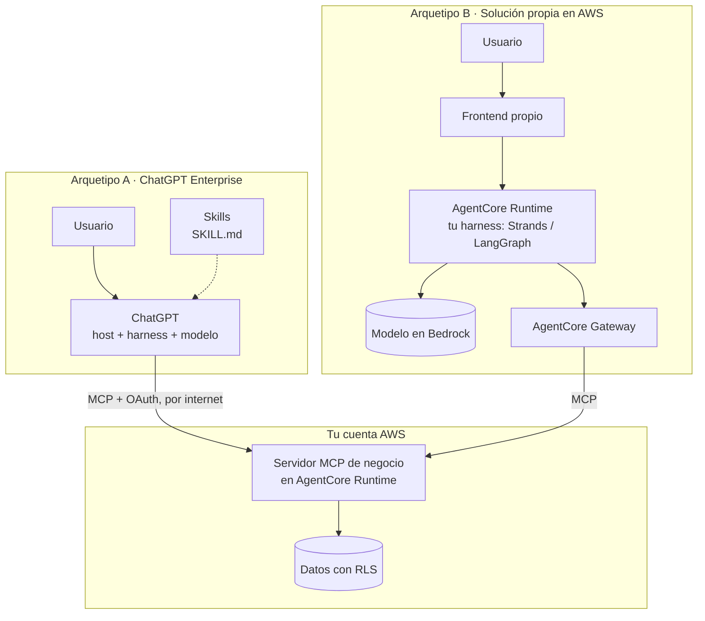
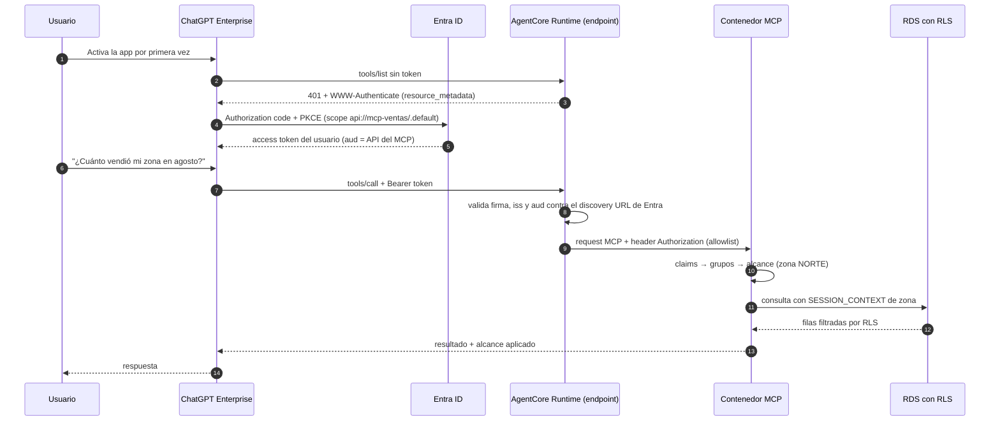
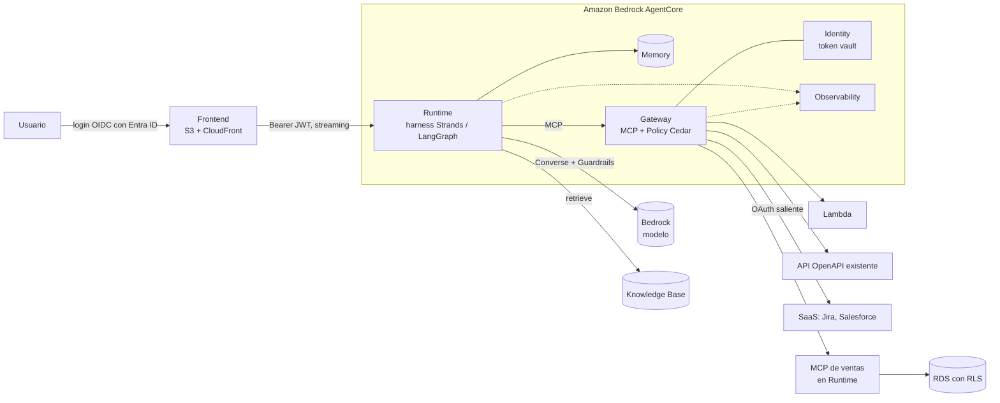

# 15 · Del concepto al servicio: ChatGPT Enterprise, Bedrock y AgentCore

!!! warning "Capítulo con fecha de vencimiento"
    Relevado en **octubre de 2026**. La mecánica es la de los capítulos 01 a 13 y no cambia. Lo que cambia es el **nombre, el estado y los límites** de cada servicio. Antes de diseñar, verificá en la documentación oficial los puntos marcados con **Verificar**.

## Concepto

Cada componente del capítulo 01 (interfaz, harness, modelo, tools, contexto, memoria, identidad, conocimiento, observabilidad) existe en tres formas:

1. **Dentro de ChatGPT Enterprise**, donde OpenAI opera casi todo y vos aportás el servidor MCP y las instrucciones.
2. **Como servicio gestionado de AWS**: Bedrock para el modelo y AgentCore para runtime, gateway, identidad, memoria y observabilidad.
3. **En infraestructura propia**: el mismo código en contenedores (ECS, EKS, Kubernetes) o en servidores.

**La arquitectura es la misma en las tres. Lo que cambia es quién opera cada caja.** Si sabés ubicar un componente en el diagrama del capítulo 01, este capítulo te dice cómo se llama en cada plataforma y qué tenés que construir si lo movés.

## Por qué existe

En la práctica se repiten dos arquetipos de solución:

- **Arquetipo A · ChatGPT Enterprise + MCP en AgentCore Runtime.** Los usuarios ya trabajan en ChatGPT. Vos publicás una **app** (tu servidor MCP) y **skills** (el flujo de trabajo), y hospedás el servidor MCP en AgentCore Runtime. Host, harness y modelo son de OpenAI.
- **Arquetipo B · Solución completa en AWS.** Frontend propio, harness propio corriendo en AgentCore Runtime, modelo consumido desde Bedrock, y tools detrás de AgentCore Gateway. Todo en tu cuenta.

Los dos comparten la pieza más valiosa: **el servidor MCP**. Por eso conviene diseñarlos juntos.



## La tabla de mapeo

La segunda columna es el arquetipo A. La tercera es la base del arquetipo B. La última es lo que usás si sacás ese componente de AWS y lo corrés vos.

| Componente (capítulo) | Arquetipo A: ChatGPT Enterprise | AWS gestionado (Bedrock + AgentCore) | Infra tradicional (servidores o contenedores) |
|---|---|---|---|
| **Interfaz** (01) | ChatGPT web, desktop y mobile. Widgets propios con MCP Apps | Frontend propio en S3 + CloudFront o Amplify Hosting. También un bot de Teams o Slack | SPA servida por Nginx, o una app Next.js en un contenedor |
| **Login del usuario** (02, 10) | SSO del workspace (SAML) y SCIM contra Entra ID | OIDC contra Entra ID (directo o federado en Cognito) y authorizer JWT del Runtime | OIDC con un middleware (oauth2-proxy o librería) contra Entra ID o Keycloak |
| **Harness y loop** (05) | De OpenAI: el chat, ChatGPT Work y los workspace agents | **AgentCore Runtime** con tu código (microVM por sesión) o **AgentCore Harness** (configuración) | El mismo contenedor en ECS, EKS o una VM, con FastAPI y Strands o LangGraph |
| **Instrucciones** (04) | **Skills** (`SKILL.md`), instrucciones de workspace agents o GPTs, descripciones de tools | System prompt en tu código, versionado en el repo | Igual: archivos versionados |
| **Modelo** (01, 02) | Modelos de OpenAI, elegidos por el usuario o el admin | **Bedrock** (Converse API, inference profiles, VPC endpoint) | API directa del proveedor, o modelo propio con vLLM u Ollama en GPU |
| **Gateway de modelos** (12) | No aplica: va en la licencia | Bedrock mismo: IAM, cuotas y application inference profiles con tags de costo | LiteLLM como proxy, con cuotas por equipo |
| **Servidor MCP** (06) | Tu servidor MCP remoto, publicado como app, alcanzable desde internet | **AgentCore Runtime con protocolo MCP**, o ECS / Lambda detrás del Gateway | Contenedor FastMCP detrás de un ALB o Nginx con TLS |
| **Catálogo y gateway de tools** (06, 07) | Directorio de apps y plugins del workspace, RBAC por app | **AgentCore Gateway** (targets Lambda, OpenAPI, MCP y Runtime) y Registry (preview) | Un servidor MCP agregador propio o una plataforma de gobernanza MCP (capítulo 14) |
| **Autorización de tools** (10) | El admin define qué roles usan la app y qué acciones piden confirmación | **AgentCore Policy** (Cedar) en el Gateway, más IAM | Cedar u OPA embebido en tu servidor |
| **Credenciales salientes** (10) | OpenAI guarda el token OAuth del usuario hacia tu servidor | **AgentCore Identity** (token vault, credential providers, OAuth 3LO) y Secrets Manager | HashiCorp Vault o Secrets Manager, más tu propio flujo OAuth y almacén cifrado de tokens |
| **Autorización de datos** (10) | En tu servidor MCP y en la base. **Igual en las tres columnas** | RLS en RDS o Aurora, Lake Formation, ABAC con session tags | RLS en Postgres o SQL Server |
| **Memoria** (04, 05) | Historial y memoria de ChatGPT, operados por OpenAI | **AgentCore Memory** (eventos de corto plazo y estrategias de largo plazo) | Tabla de sesiones en Postgres, Redis o DynamoDB, y un job de resumen |
| **Conocimiento y RAG** (09) | Archivos de proyectos o GPTs, conectores de SharePoint o Drive, o una tool de búsqueda en tu MCP | **Bedrock Knowledge Bases** sobre S3 Vectors, OpenSearch Serverless o Aurora pgvector | Pipeline de ingesta propio sobre pgvector, OpenSearch o Qdrant |
| **Ejecución de código** (05) | Herramientas de OpenAI (análisis de datos, ChatGPT Work) | **AgentCore Code Interpreter** y Browser | Contenedores efímeros con gVisor o Firecracker |
| **Guardrails** (12) | Moderación de OpenAI y controles de admin | **Bedrock Guardrails** (`ApplyGuardrail`, también aplicable en el Gateway) | NeMo Guardrails, LLM Guard, Presidio |
| **Observabilidad** (12) | Solo ves las llamadas a tu servidor. La conversación, vía Compliance API | **AgentCore Observability** (OpenTelemetry, CloudWatch) y CloudTrail | Collector de OpenTelemetry hacia Langfuse, Phoenix o Grafana |
| **Evals** (12) | Tests de tus tools y evals manuales end-to-end | **AgentCore Evaluations** (online y batch) | promptfoo o Langfuse en CI |
| **Costo** (12) | Licencia por asiento | Por token (Bedrock) y por consumo de cada componente de AgentCore | Por token o por GPU, más la infraestructura |

!!! tip "La fila que no cambia nunca"
    **Autorización de datos.** En las tres columnas, el filtro por usuario vive en el servidor MCP y en la base, derivado del token validado. Ninguna plataforma lo resuelve por vos (capítulo 10).

## Arquetipo A · ChatGPT Enterprise con MCP en AgentCore Runtime

### Qué construís y qué no

| Lo construís vos | Lo pone OpenAI | Lo pone AWS |
|---|---|---|
| El servidor MCP (tools, autorización, auditoría) | Host, harness, modelo, memoria | El runtime del servidor MCP: microVM, escalado, endpoint HTTPS |
| Las skills (flujo de trabajo, definiciones de negocio, formato de salida) | El directorio de apps y plugins, RBAC y confirmaciones | La validación del JWT de entrada |
| La app registration en Entra ID | El cliente OAuth que inicia el login | Logs y métricas del runtime |

### Skills y MCP: una división de roles clara

En ChatGPT, un **plugin** respaldado por MCP combina dos cosas con roles complementarios:

- **El servidor MCP** aporta **datos, autenticación, autorización y acciones.**
- **La skill** aporta **el flujo de trabajo**: cuándo llamar a cada tool, en qué orden, cómo manejar resultados incompletos y qué tiene que contener la respuesta.

Una skill es una carpeta con un `SKILL.md` (nombre, descripción que dice cuándo aplica, instrucciones) y opcionalmente plantillas, ejemplos o scripts. El modelo ve solo el nombre y la descripción hasta que el pedido coincide. Recién ahí carga las instrucciones completas: es *progressive disclosure*, el mismo patrón del capítulo 04.

```markdown
---
name: reporte-ventas-zona
description: Usar cuando el usuario pida ventas, márgenes o ranking de clientes de su zona o de un período.
---

1. Si el período no está claro, preguntá antes de consultar. La campaña va de julio a junio.
2. Llamá a `get_kpi_ventas` con el período y el KPI. **Nunca pidas ni pases la zona**: la decide el servidor.
3. Si el resultado viene vacío, decí qué alcance se aplicó (viene en el campo `alcance`) en lugar de inventar.
4. Respondé con una tabla y una línea de conclusión. Citá la fuente y la hora de actualización.
```

**La regla:** la skill **orienta**, el servidor **garantiza**. Una skill nunca contiene autorización ("no muestres otras zonas"), porque el modelo la puede ignorar. Eso va en el servidor MCP, derivado del token.

Las skills siguen el formato abierto Agent Skills: el mismo `SKILL.md` se puede usar en Claude, en Codex o como parte del system prompt de un harness propio. **Son portables, como el servidor MCP.**

### El flujo de identidad



### Qué configurás, paso a paso

1. **Servidor MCP.** Streamable HTTP en `0.0.0.0:8000/mcp`, en modo stateless (`stateless_http=True` en FastMCP). Es el mismo servidor que corrés en tu laptop.
2. **Runtime.** Lo desplegás con protocolo MCP y authorizer JWT:

    ```bash
    agentcore add agent \
      --name ventas-mcp \
      --language Python \
      --protocol MCP \
      --authorizer-type CUSTOM_JWT \
      --discovery-url "https://login.microsoftonline.com/<tenant-id>/v2.0/.well-known/openid-configuration" \
      --request-header-allowlist Authorization
    agentcore deploy
    ```

    Para llegar a RDS, el runtime va en **modo VPC** (sus interfaces de red quedan en tus subredes privadas). El endpoint de entrada sigue siendo el de AgentCore: `https://bedrock-agentcore.<región>.amazonaws.com/runtimes/<ARN codificado>/invocations?qualifier=DEFAULT`.

3. **Entra ID.** Una app registration para la API del MCP, que expone un scope y emite tokens v2. Otra para ChatGPT como cliente, con la redirect URI que te muestra ChatGPT al crear la app.
4. **ChatGPT.** El admin habilita el modo desarrollador, crea la app con la URL del runtime y la configuración OAuth, escanea las tools, la prueba como borrador y la publica. Después define qué roles la usan y qué acciones piden confirmación.
5. **Skills.** Se suben y se comparten o publican en el workspace según los permisos que habilite el admin.

!!! warning "Verificar antes de implementar"
    - **Emisor de los tokens de Entra.** Si la app registration de la API emite tokens v1, el `iss` no coincide con el discovery URL v2 y el runtime rechaza todo. Configurá la API para tokens v2 (`requestedAccessTokenVersion: 2` en el manifiesto).
    - **Validación del cliente.** Los tokens v2 de Entra identifican al cliente en el claim `azp`, no en `client_id`. Validá por **audiencia** (`allowedAudience`) y comprobá qué claims revisa `allowedClients` antes de usarlo.
    - **Registro del cliente.** ChatGPT soporta CIMD, DCR y clientes predefinidos. Con Entra lo práctico es un cliente predefinido (client ID y secreto cargados en ChatGPT). Probalo contra tu tenant.
    - **El servidor igual valida.** El runtime ya verificó la firma, pero tu servidor debería volver a validar `aud` y `exp` con el JWKS. Es barato y te protege si mañana cambia la configuración del runtime.

### Límites de este arquetipo

- **El endpoint es de AWS, no tuyo.** No le podés poner tu WAF ni tu dominio delante, ni restringir por IP de origen como en un ALB. Si alguna de esas cosas es obligatoria, el mismo contenedor corre en **ECS + ALB + WAF** (topología T2 del capítulo 07).
- **Los resultados de las tools van a OpenAI.** El modelo los necesita para responder. Revisá contrato y retención (capítulo 08).
- **Observabilidad parcial.** Ves cada llamada a tu servidor en CloudWatch, pero no el razonamiento del modelo.

## Arquetipo B · Solución completa en AWS



### Cómo se reparte cada decisión

| Decisión | Opción recomendada | Por qué |
|---|---|---|
| Harness | **AgentCore Runtime con tu código** (Strands o LangGraph) | Control del loop y portabilidad. AgentCore Harness (configuración) es más rápido de arrancar, pero el loop queda atado a AWS |
| Modelo | Bedrock con **inference profile** propio por aplicación | Costo atribuible por tags, cuotas y cambio de modelo sin tocar código |
| Contexto de negocio | System prompt versionado en el repo, más skills como archivos | Lo controlás y lo podés evaluar en CI |
| Tools | Servidores MCP detrás del Gateway | Un solo endpoint MCP, políticas Cedar y auditoría centralizada |
| Memoria | AgentCore Memory | Sesión e historial fuera del proceso: el harness queda stateless |
| Documentos | Knowledge Base expuesta como **tool** de búsqueda | El agente decide cuándo buscar (capítulo 09) |
| Guardrails | Bedrock Guardrails en las llamadas al modelo | PII y temas denegados, como capa adicional y nunca como único control |
| Evals | AgentCore Evaluations y una suite propia en CI | Las del servicio para producción, las propias para cada cambio |

### Propagación de identidad

El JWT del usuario entra al Runtime, el harness lo reenvía al Gateway y el Gateway decide por política Cedar qué tools puede usar ese usuario. El punto delicado es **el último salto, hasta el servidor MCP que filtra los datos**:

!!! warning "Verificar: el último salto"
    Al momento de escribir, la autenticación saliente del Gateway hacia un target MCP usa **client credentials** (máquina a máquina), no delegación del usuario. Si tu servidor MCP necesita la identidad del usuario para aplicar RLS, tenés dos caminos:

    1. El harness llama a **ese servidor MCP directo** con el token del usuario, y el Gateway queda para las tools que no filtran por usuario.
    2. El Gateway pasa los claims del usuario al target (por ejemplo, con interceptores de request), y el servidor confía en ellos **solo** si la llamada viene del Gateway (`allowedWorkloadConfiguration`).

    Elegí uno y escribí un test de autorización que lo pruebe de punta a punta.

## Portabilidad: de servicio gestionado a infra tradicional

### Por qué es posible

AgentCore Runtime **no te pide un formato propietario: corre tu contenedor** con un contrato HTTP simple. Un agente atiende `POST /invocations` y `GET /ping` en el puerto 8080. Un servidor MCP atiende `/mcp` en el puerto 8000. Ese contenedor corre igual en ECS, en Kubernetes o en una VM.

Lo que **no** viaja con el contenedor son los servicios que lo rodean. Eso es lo que tenés que reconstruir:

| Servicio gestionado | Qué te resolvía | Qué construís fuera | Esfuerzo |
|---|---|---|---|
| **AgentCore Runtime** | Aislamiento por sesión, escalado, validación del JWT de entrada | ECS o Kubernetes + ALB + middleware JWT. Si el agente ejecuta código, una sandbox por sesión | Medio |
| **AgentCore Gateway** | Convertir APIs y Lambdas en tools MCP, autorización Cedar, un endpoint único | Servidores MCP propios que envuelvan cada API, y la autorización en cada uno | Medio a alto |
| **AgentCore Identity** | Tokens OAuth salientes por usuario, consentimiento 3LO, vault | Vault, flujo OAuth propio por proveedor y almacén cifrado de tokens con refresh | **Alto** (el más subestimado) |
| **AgentCore Memory** | Historial de sesión y memoria de largo plazo | Tabla de sesiones y un job que resuma | Bajo a medio |
| **Bedrock** | Muchos modelos con IAM, VPC endpoint y facturación en tu cuenta | API directa del proveedor (bajo), o modelo propio en GPU con vLLM (alto) | Bajo a alto |
| **Knowledge Bases** | Ingesta, chunking, embeddings, índice | Pipeline de ingesta y pgvector u OpenSearch | Medio |
| **Guardrails** | Detección de PII, temas y ataques de prompt | Librerías (Presidio, LLM Guard, NeMo) | Medio |
| **Observability** | Traces y métricas sin instrumentar a mano | Collector de OpenTelemetry y un backend (Langfuse, Grafana) | **Bajo, si ya instrumentaste con OTel** |
| **ChatGPT (host + harness)** | Todo el frente del usuario | No se migra: se reemplaza por el arquetipo B. **Se llevan el servidor MCP y las skills** | — |

### Mismo servidor, tres destinos

El código del servidor MCP es idéntico. Lo que cambia es el empaquetado y quién valida el token antes de que llegue.

=== "AgentCore Runtime"

    ```bash
    # El runtime valida el JWT y entrega el request en :8000/mcp
    agentcore add agent --name ventas-mcp --protocol MCP \
      --authorizer-type CUSTOM_JWT --discovery-url "$ENTRA_DISCOVERY_URL" \
      --request-header-allowlist Authorization
    agentcore deploy
    ```

=== "Contenedores (ECS)"

    ```dockerfile
    # Mismo servidor; el JWT lo valida tu middleware y TLS lo termina el ALB
    FROM python:3.12-slim
    WORKDIR /app
    COPY . .
    RUN pip install --no-cache-dir -r requirements.txt
    EXPOSE 8000
    CMD ["python", "server.py"]
    ```

    Delante: ALB con certificado ACM y WAF. Secretos de la base vía el rol de la task y Secrets Manager.

=== "Servidor (VM)"

    ```ini
    # /etc/systemd/system/ventas-mcp.service
    [Service]
    ExecStart=/opt/ventas-mcp/.venv/bin/python /opt/ventas-mcp/server.py
    EnvironmentFile=/etc/ventas-mcp/env
    Restart=always
    User=ventas-mcp
    ```

    Delante: Nginx con TLS como reverse proxy hacia `127.0.0.1:8000`.

### Siete reglas para que mover un componente sea un cambio de deploy

1. **Tools en MCP, autorización en el servidor y en la base.** Nunca en el prompt, en la skill ni solo en la plataforma.
2. **Harness en un framework open source** (Strands, LangGraph) si la portabilidad importa. La configuración de AgentCore Harness no sale de AWS.
3. **El modelo detrás de una interfaz única** (Converse o LiteLLM), no el SDK de un proveedor repartido por el código.
4. **OIDC estándar y validación del token también en tu código**, aunque la plataforma ya lo valide.
5. **OpenTelemetry desde el día uno.** Es lo que hace que la observabilidad se mude sin reescribir.
6. **Estado fuera del proceso.** Sesión y memoria en un store, contenedor stateless.
7. **Instrucciones y skills como archivos versionados**, e infraestructura en Terraform por componente.

## Cómo elegir entre A y B

| Si… | Arquetipo |
|---|---|
| Los usuarios ya trabajan en ChatGPT y el caso es de consulta | **A** |
| Querés probar valor en semanas | **A**, con el servidor MCP bien hecho |
| El flujo tiene pasos obligatorios, aprobaciones o necesita evals automáticas | **B** |
| Los datos o los resultados de las tools no pueden salir de AWS | **B** |
| Necesitás una UI propia, integrada a otra aplicación, o el agente corre sin usuario | **B** |
| Empezás con A y el caso crece | Pasás a **B** reutilizando servidor MCP y skills. Lo que tirás es la configuración de la app |

## Antipatrones

| Antipatrón | Consecuencia |
|---|---|
| Poner reglas de acceso en la skill ("no muestres otras zonas") | El modelo las puede ignorar. La autorización es del servidor |
| Confiar solo en la validación del runtime y no mirar el token en el servidor | Si cambia la configuración del authorizer, el servidor queda abierto sin que nadie lo note |
| Usar AgentCore Harness por velocidad cuando ya sabés que vas a necesitar salir de AWS | El loop hay que reescribirlo |
| Usar el Gateway con client credentials hacia el MCP de datos y "filtrar en el harness" | El servidor de datos ve una sola identidad técnica: es el *confused deputy* del capítulo 10 |
| Instrumentar con APIs propietarias de un proveedor de observabilidad | Mudar la observabilidad implica reinstrumentar todo |
| Dar por sentado que "gestionado" significa "seguro" | AWS y OpenAI protegen su plataforma. La autorización de tus datos es tuya |

## Recall

??? question "En el arquetipo A, ¿qué construís vos, qué pone OpenAI y qué pone AWS?"
    **Vos:** el servidor MCP (tools, autorización, auditoría), las skills y la app registration en Entra ID. **OpenAI:** host, harness, modelo, memoria, directorio de apps, RBAC y el cliente OAuth. **AWS:** el runtime que corre el contenedor del servidor MCP, su escalado, el endpoint HTTPS y la validación del JWT de entrada.

??? question "¿Qué va en la skill y qué va en el servidor MCP? Dá un ejemplo de algo que nunca puede ir en la skill."
    **Skill:** el flujo de trabajo (cuándo llamar a cada tool, en qué orden, cómo manejar vacíos, formato de la respuesta, definiciones de negocio). **Servidor MCP:** datos, autenticación, autorización y acciones. Nunca va en la skill una **regla de acceso** como "mostrá solo la zona del usuario": el modelo la puede ignorar, y el alcance tiene que salir del token validado en el servidor.

??? question "Tu servidor MCP corre en AgentCore Runtime y seguridad exige WAF propio y restricción por IP de origen. ¿Qué hacés?"
    El endpoint del Runtime es de AWS, así que no le podés poner tu WAF delante. Llevás **el mismo contenedor** a ECS detrás de un ALB con WAF y certificado propio (topología T2), y le agregás un middleware que valide el JWT, porque ese trabajo lo hacía el runtime. El código de las tools no cambia.

??? question "Migrás el arquetipo B de AgentCore a Kubernetes. Ordená los componentes del más fácil al más difícil de reconstruir."
    1. **Observabilidad**, si ya usabas OpenTelemetry: cambiás el destino del collector.
    2. **Runtime**: el contenedor corre igual. Agregás ingress, validación del JWT y escalado.
    3. **Memoria**: una tabla de sesiones y un job de resumen.
    4. **Modelo**: trivial si pasás a la API del proveedor; caro si hostéas el modelo en GPU.
    5. **Gateway**: un servidor MCP por cada API que antes traducía y autorización en cada uno.
    6. **Identity**: flujos OAuth por proveedor, consentimiento, almacén cifrado y refresh de tokens. Es el más subestimado.

??? question "En el arquetipo B, ¿por qué el último salto hasta el servidor MCP de datos es el punto delicado de la identidad?"
    Porque el servidor de datos es el que aplica el filtro por usuario (RLS). Si el Gateway llega a ese servidor con **client credentials**, el servidor ve una identidad técnica que tiene acceso a todo: es un *confused deputy*. Hay que asegurar que la identidad del usuario llegue hasta ahí, llamándolo directo con el token del usuario o pasando sus claims desde un Gateway en el que el servidor confía de forma explícita, y probarlo con un test de autorización.

## Fuentes

Verificadas el 2026-10-14.

- [AWS — Deploy MCP servers in AgentCore Runtime](https://docs.aws.amazon.com/bedrock-agentcore/latest/devguide/runtime-mcp.html)
- [AWS — Inbound Auth y Outbound Auth en AgentCore Runtime](https://docs.aws.amazon.com/bedrock-agentcore/latest/devguide/runtime-oauth.html)
- [AWS — AgentCore harness (developer guide)](https://docs.aws.amazon.com/bedrock-agentcore/latest/devguide/harness.html)
- [AWS — Introducing AgentCore Gateway](https://aws.amazon.com/blogs/machine-learning/introducing-amazon-bedrock-agentcore-gateway-transforming-enterprise-ai-agent-tool-development/)
- [OpenAI — Skills (plugins)](https://developers.openai.com/plugins/concepts/skills)
- [OpenAI — Skills in ChatGPT](https://help.openai.com/en/articles/20001066-skills-in-chatgpt)
- [OpenAI — Apps SDK: autenticación](https://developers.openai.com/apps-sdk/build/auth)
- [OpenAI — Developer mode and MCP apps in ChatGPT](https://help.openai.com/en/articles/12584461-developer-mode-and-mcp-apps-in-chatgpt)
- [OpenAI — ChatGPT Enterprise & Edu release notes](https://help.openai.com/en/articles/10128477-chatgpt-enterprise-edu-release-notes)
